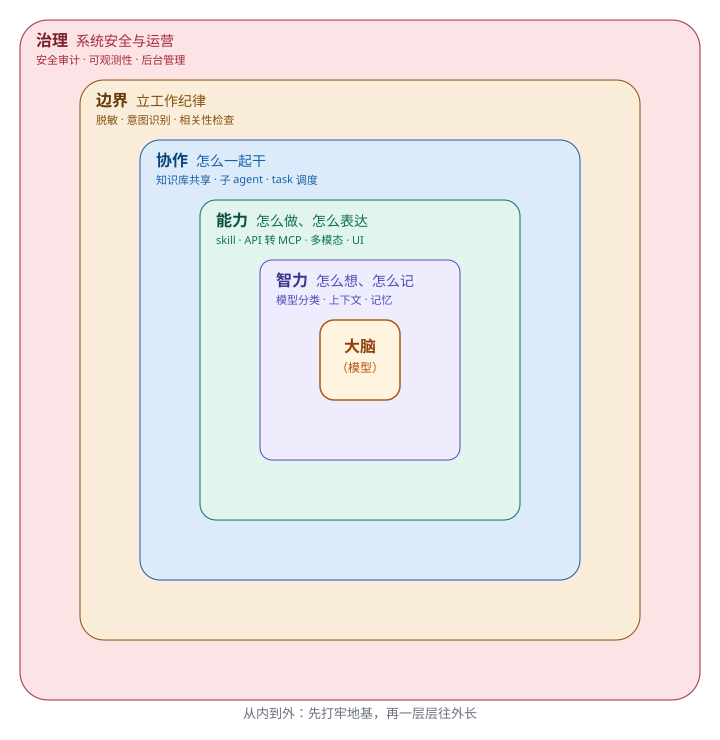

# 第 2 章　一张图看懂企业级 Agent

> 全书的地图。以后每一章，都在这张图里找到自己的位置。

---

## 新同事入职的第一天

想象你刚招进来一个高潜力的新同事，叫小 A。他聪明、反应快、什么话题都能接上几句。

入职第一天，你会怎么带他？

你不会一上来就把最难的项目甩给他，也不会第一天就让他去碰客户的报价单。你会先做一件很自然的事：**带他把公司的「地图」走一遍**。

你会告诉他——

- 你的**工位**在这，你的电脑、你的脑子都归你自己管，这是你安身立命的地方；
- 公司的**工具房**在那，打印机、内部系统、各种软件都在里面，要用就去领；
- **同事**在隔壁，遇到一个人干不完的活，要学会找人搭把手；
- 墙上贴着**员工手册**，哪些能说、哪些不能碰、报销要走什么流程，都写在上面；
- 最后还有**行政和 HR**，谁负责发工资、谁负责门禁、出了问题找谁，这些是让整个公司能正常运转的「后台」。

这一圈走下来，小 A 心里就有了一张地图：**原来公司是这样运转的，我站在哪里，我旁边有什么，出了事该找谁。**

**一个企业级 Agent，长得和这个一模一样。**

它同样是由一圈一圈的模块「包」起来的。这一章，就把这张地图摊开给你看——不写代码，只看结构。

---

## 企业级 Agent 是什么：一个「洋葱」

上一章我们说过一句话，是全书最重要的一句话：

> **Agent 不是一个「更强的模型」，而是一套「让模型变得靠谱的系统」。**

这套系统长什么样？它像一个**洋葱**，从里到外一共五层：

| 从里到外 | 这一层叫什么 | 它回答的问题 | 一句话概括 |
|---|---|---|---|
| 最核心 | **大脑（模型）** | 靠什么想 | 一个聪明、但还没长全的大脑 |
| 第 1 层 | **智力** | 怎么想、怎么记 | 让它想得清、记得住 |
| 第 2 层 | **能力** | 怎么做、怎么表达 | 让它做得成、说得清 |
| 第 3 层 | **协作** | 怎么一起干 | 让它和别的 agent、别的活、以及人配合好 |
| 第 4 层 | **边界** | 立什么规矩 | 给它立一套工作纪律 |
| 第 5 层 | **治理** | 系统怎么管 | 把安全、权限、健康、运营这些系统级的事管起来 |

洋葱这个比喻，比「清单」准得多。下面这一节，我们一层一层拆开看。

---

## 一层一层拆开看

### 最核心：大脑（模型）

洋葱的芯，是一颗**大脑**——也就是那个大语言模型。

它负责「想」。你抛给它一句话，它理解你的意思，组织语言，给出回答。这是整个 Agent 唯一「与生俱来」的部分。

但请记住上一章那句扎心的话：**它只有一个能考 140 分的大脑，记性、手脚、分寸，都还是空白。** 所以它自己一个人，什么事都办不成。它需要外面一圈一圈的「成长」。

### 第 1 层 · 智力：怎么想、怎么记

紧贴大脑的一层，是**智力**。这一层解决的是大脑的两个先天缺陷：**记性差**、**不会挑脑子**。

- **模型分类**：一个公司不会只雇一种人——有的岗位要聪明能扛大活的，有的岗位只要手脚快、成本低。模型也一样，快的、强的、便宜的，各有所长，要「分层使用」。
- **session 上下文**：大脑「接不上话」是因为它记不住上一句。这一层负责把一次对话的来龙去脉管好，让它「接得上话」。
- **记忆沉淀**：光记住这一次对话还不够，还要把有价值的结论「沉淀」下来，下次、下个人、下个项目都能用。

这一层回答一句话：**怎么让它想得清、记得住。**

### 第 2 层 · 能力：怎么做、怎么表达

有了脑子，还得有手脚和嘴。**能力**这一层，就是给 Agent 装上的「手」和「嘴」。

- **skill（技能包）**：模型只会「说」，不会「做」。skill 就是它的手和脚——查数据库、发邮件、算账、改文件，都是靠 skill 长出来的。
- **API 转 MCP**：外部世界的接口五花八门，这一层把散落的 API 收拢成一套统一的「工具协议」，让 Agent 能按统一的方式去调用。
- **多模态**：让它听得见（语音）、看得见（图片）、说得出，而不是只会打字。
- **UI 与交互**：它在「黑盒」里干活，人得看得见、信得过。这一层负责把它的「想」和「做」透明地画出来。

这一层回答一句话：**怎么让它做得成、说得清。**

### 第 3 层 · 协作：怎么一起干

一个人再能干，也干不了所有活。**协作**这一层，解决的是「怎么一起干」。

- **知识库**：把公司的知识攒成「家底」——像专利、客户名单、SOP 一样，越沉淀越值钱。Agent 随时能去「查公司的家底」。
- **子 agent**：一个人既当医生又当护士，会乱。专业的事交给专业的「人」——让 Agent 在需要时调一个更专业的「子 agent」来拿主意。
- **task 调度**：有些活要跑几分钟，不能干等。把慢活和快活分开，排队、并发、可回收。

这一层回答一句话：**怎么让它和别的 agent、别的活、共享的知识、以及人配合好。**

### 第 4 层 · 边界：立一套工作纪律

能力越大，越要立规矩。**边界**这一层，管的是「模型」这个人的**言行**——像给新员工立一套工作纪律。

- **脱敏**：守住商业秘密和个人隐私——配方、报价、身份证号、病历，不让模型「不小心」说出去。
- **意图识别**：一句话背后可能是十个意思，先搞清楚「你到底想干什么」，再动手。
- **相关性检查**：信息一多，模型就容易「分心」。让它的注意力始终放在「当前最要紧」的那件事上。

这一层回答一句话：**怎么让它守口如瓶、先想清楚再干、只专注最要紧的事。**

### 第 5 层 · 治理：系统级安全与运营

边界管的是「模型」这个人；**治理**管的是「整套系统」——当一百个人、一百个 Agent 一起跑的时候，谁来管。

- **安全审计**：谁能干什么、钥匙放哪、干过什么要留痕。天才同事也有权限边界。
- **可观测性**：一个能干的员工，也得「看得见」才管得住——进度到哪了、成果是什么、有没有跑偏。
- **后台管理**：管人（谁能进来）、管权（谁能干什么）、管资源（谁能配什么模型）、管流程（邀请制怎么招人）。

这一层回答一句话：**怎么把安全、权限、进度与成果的监督、运营，都管起来。**

---

## 为什么是「五层」，而不是一个清单

你可能想问：这五个模块，为什么要排成一个「洋葱」，而不是列成一张清单？

这里藏着一个很关键的设计道理，也是这一章的「巧思」：

> **这五层不是并列的关系，而是「层层包裹、由内而外」的依赖关系。**

有三个推论，值得你记住：

**推论一：内层是地基，外层是保障。**
洋葱有一个好处——**剥掉外面一层，里面还能活；抽掉里面的芯，整颗就散了。** Agent 也一样：你把「治理」这一层拆了，它照样能对话，只是少了安全兜底；但你要是把「大脑」抽了，或者把「记忆」弄丢了，那什么都白搭。所以建系统，必须**从内往外建**：先把脑子、记忆打扎实，再谈手脚、再谈协作、最后谈治理。

**推论二：外层依赖内层，内层不依赖外层。**
「协作」这一层要调「子 agent」，前提是「能力」那一层已经把「调用工具」这件事做扎实了；「边界」这一层要在输出前「脱敏」，前提是「智力」那一层已经能把话说完整。反过来，最内层的模型，完全不需要知道「外面还有一层治理」。**每一层只对里面那一层负责，不为外面那一层操心。**

**推论三：越往外，越像「管人」而不是「管技术」。**
你有没有发现，越往内，越接近「技术问题」（模型怎么选、上下文怎么存）；越往外，越接近「管理问题」（谁能进来、谁有权、干过什么要留痕）。这不是巧合——**一个靠谱的 Agent，本质上就是一个「靠谱的员工」，员工的问题，最后都会回到管理上来。**

这三条推论，就是全书的结构逻辑。后面五大部分，就是顺着这个洋葱，从里到外，一层一层带你走。

---

## 一张图，记住全书

现在，回到开头那幅图。你只需要记住三件事：

1. **最中间是一颗大脑**——它聪明，但还没长全；
2. **外面包着五层**——智力、能力、协作、边界、治理；
3. **顺序是从里到外**——先把内层打扎实，再一层层往外长。

这本书剩下的 16 章，就是带着你，把这个洋葱从里到外，一层一层「长」出来。

带着这张地图，我们出发。第一站，也是最里面的一站——**先看看那颗大脑，到底该怎么挑、怎么用。**

---

> 本章配图（已产出，存于 assets/）：
> - 图 2-1　示意图：fig-2-1-agent-onion.svg（洋葱式五层结构）
