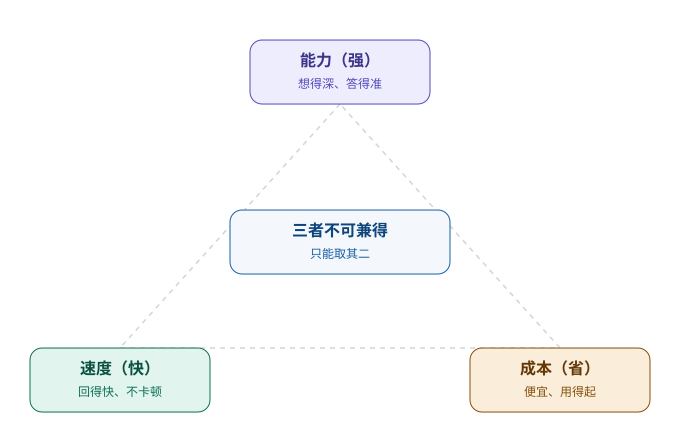

# 第 3 章　一队大脑，而不是一个大脑

> 第一部分 · 智力。这一章讲：agent 靠什么「想」——不是靠一个万能大脑，而是靠「一队」各有所长的大脑。

---

## 为什么你的公司，不只有一种员工

想象你的公司要招人，你会怎么招？

你不会只招一种人。你会招**聪明绝顶、能扛大项目**的资深工程师，也会招**手脚麻利、工资便宜**的实习生；有些岗位要的是「深度」，比如写核心算法；有些岗位要的是「速度」，比如每天处理几百条客服工单；有些岗位要的是「省钱」，比如把一堆重复性的数据整理交给新人。

你会很自然地做一件事：**按岗位，配不同的人。** 没有一个老板会说「我只要最聪明的、最贵的，其他统统不要」——那样公司早就破产了。

**给 Agent 选模型，是同一回事。**

很多人对「大模型」有一个朴素的误解：以为模型是「越大越强、越强越好」，最好全用最顶级的那一个。但真实情况是——**没有「最好」的模型，只有「最合适」的模型。**

---

## 模型的三样「本事」，永远在打架

如果把一个模型当成一个员工，我们会看它的三样东西：

| 你要什么 | 对应模型的什么 | 代价是什么 |
|---|---|---|
| 想得深、答得准 | **能力强**（更大的模型） | 慢、贵 |
| 回得快、不卡顿 | **速度快**（更小的模型） | 可能答得糙 |
| 成本低、用得起 | **便宜**（更小的模型、或更省的用法） | 能力或速度要打折 |

这三样东西，**永远在互相打架**，你不可能三样都要。就像你不能要求一个员工「既是天才、又便宜、还随叫随到」——天底下没有这样的好事。

所以选模型，本质上是**在这三样里做取舍**：

- 要「准」，就多花点钱、多等一会儿；
- 要「快」，就别指望它能解最难的题；
- 要「省」，就把那些「不用动脑」的活交给它。

这不是模型的缺陷，这是**所有「人」的共性**。理解了这一点，你才不会掉进「追最强模型」的坑里。

---

## 巧思一：分层用模型——难的用贵的，简单的用便宜的

既然没有最好的，只有最合适的，那聪明的做法就呼之欲出了：

> **不要用一个模型干所有活，而是「看菜下饭」——难的活交给强模型，简单的活交给便宜的小模型。**

一个企业级 Agent，一天里要干的事五花八门：

- 判断用户这句话「是不是一个任务、要不要规划」——这件事简单、高频、要求快，一个小模型就够；
- 把一段长对话「压缩成几行摘要」——这件事不难，但要便宜，因为一天要压缩几千次，用小模型能省一大笔钱；
- 回答一个「帮我分析一下这份财报的风险」——这件事难，要真本事，得用强模型。

如果这三件事你都用同一个「最强的模型」去干，结果就是：**钱花得最多，速度还不快。** 就像让一个年薪百万的首席架构师，去给公司前台贴报销单——不是他干不了，是**划不来**。

所以企业级 Agent 的模型层，通常不是一个模型，而是**一队模型**：

| 场景 | 用什么模型 | 为什么 |
|---|---|---|
| 复杂推理、专业分析、写重要报告 | 强模型 | 要深度、要准确 |
| 日常对话、意图判断、简单问答 | 中模型 | 平衡速度与质量 |
| 摘要压缩、打标签、格式整理 | 小模型 | 高频、便宜、够用就行 |

「分层用模型」这件事，听起来平平无奇，但它带来的收益是实实在在的：**同样的预算，你能服务的用户更多、速度更快，而真正难的那 10% 的活，也一点没耽误。**

---

## 巧思二：把「聪明的脑子」和「可靠的系统」分开

分层用模型，是第一层巧思。还有第二层，更反直觉一点：

> **别指望模型「又聪明又可靠」。聪明，是模型的；可靠，是系统的。**

这句话怎么理解？

一个模型可以「很聪明」——它能写出惊艳的回答、给出深刻的洞察。但「聪明」不等于「可靠」。模型会胡说八道（一本正经地编造）、会答非所问、会偶尔抽风。这些是「脑子」的天性，你没法靠换一个模型来根治。

真正让系统「可靠」的，是模型**外面**那圈工程化的设计——也就是后面几章要讲的：上下文怎么管、记忆怎么存、边界怎么立、权限怎么控。

所以你会看到一个很有意思的分工：

- **模型负责「聪明」**：给出好的、有洞见的回答。这块，选强的、选对的。
- **系统负责「可靠」**：保证不出格、不泄密、不跑偏、干了什么有据可查。这块，靠设计、靠纪律，不靠模型。

这就像公司里，**「能干的员工」和「靠谱的制度」是两码事**。再能干的员工，也得靠制度兜底；再强的模型，也得靠系统兜底。很多人一上来就把「让系统更靠谱」的希望，全押在「换一个更聪明的模型」上，方向就错了。

---

## 这一章，你只要带走三句话

1. **没有「最好」的模型，只有「最合适」的模型**——能力、速度、成本，永远在打架，你得做取舍；
2. **分层用模型**——难的用贵的，简单的用便宜的，别让首席架构师去贴报销单；
3. **聪明归模型，可靠归系统**——别指望换一个更强的模型，就能解决可靠性的问题。

想清楚了「靠什么想」，下一个问题自然就来了：**大脑虽然聪明，但它「记不住上一句」，一次对话都接不上，还谈什么干活？**

这就把我们带到了下一章——**session 上下文管理**。

---

> 本章配图（已产出，存于 assets/）：
> - 图 3-1　示意图：fig-3-1-model-tradeoff.svg（能力 / 速度 / 成本的取舍三角）
