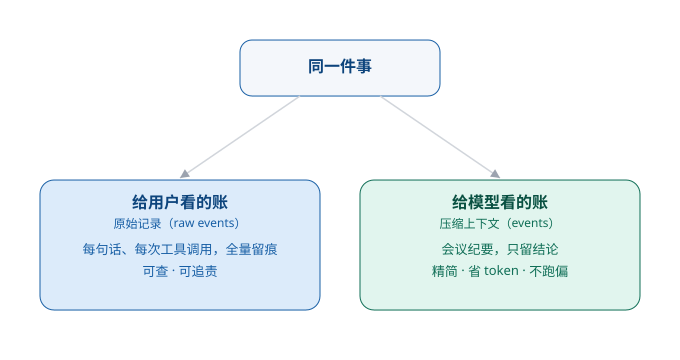

# 第 4 章　一次对话，靠什么「接得上话」

> 第一部分 · 智力。这一章讲：agent 怎么「记住一次对话」——记住的秘诀，不是「全都记」，而是「记对账」。

---

## 一个「每次见面都失忆」的新同事

想象你的新同事小 A，有一个奇怪的毛病：**他每次开口，都像第一次见你。**

你跟他聊了十分钟，把项目的来龙去脉、你的需求、你忌讳的点，一五一十都交代清楚了。他听得也很认真，连连点头。可你只要一转身去倒杯水，回来接着往下聊，他一脸茫然地问你：「不好意思，我们刚才聊到哪了？」

你不信，又把前因后果说了一遍。结果他刚答完你这句话，下一句又问：「你说的『那个数据』，是哪个数据？」

**聊三句，忘两句。** 这样的同事，再有本事，你也没法跟他共事。

这就是一个**没有「上下文管理」的模型**。

模型本身，是个「金鱼脑」——它不会自己「记得」你们聊过什么。你每问一句，它都当成一个全新的、孤立的问题来回答。让它「接得上话」的，不是模型自己，而是系统在背后做的**上下文管理**。

这一章，就讲这套「接得上话」的功夫。

---

## 上下文，到底是什么

先把它说清楚。

**上下文（context），就是「模型在回答之前，眼前能看到的所有东西」。**

它通常包括三样：

1. **你刚说过的话**（用户消息）——你这次问了什么、附了什么文件；
2. **它自己刚说过的话**（助手回复）——它上一轮是怎么回答的；
3. **系统提前塞给它的「背景」**（系统提示、角色设定）——告诉它「你是谁、你要遵守什么规矩」。

模型每次要说话，就是把这堆「上下文」摊在眼前，读一遍，然后接着往下说。**它「接得上话」，全靠这份上下文；它「接不上话」，也全因为这份上下文丢了或乱了。**

所以，上下文管理，本质就是两件事：

- **往哪存**：这份「眼前的对话」要实时地、准确地记下来，不能丢、不能乱；
- **装多少**：模型「眼前」能装的东西是**有限的**（这就是所谓的「上下文窗口」），装不下的时候，怎么办。

下面，我们一件一件看。

---

## 第一件事：对话是「边说边记」的，怎么记才不丢

一个对话，不是「你说一句、它答一句」这么死板。真实情况复杂得多：

- 模型是**流式输出**的——它不是憋着一整段话一次性吐出来，而是一个字一个字往外冒，像人说话一样「边说边想」。你会看到字一行一行地「长」出来。
- 一次对话里，模型可能**中途调用工具**——它说着说着，跑去查了个数据库，查完回来接着往下说。
- 一个对话里，可能**同时有好几段消息**在生成、在更新。

这就带来一个很实际的问题：**这些东西，什么时候「记下来」才算数？**

如果模型刚冒了三个字，你就把这「半句话」记进账本里，那账本里就会塞满一堆「半截的话」——既不完整，也没法用。

所以这里有一个极其重要的巧思：

> **事件缓冲：一句话要「说完整了」，才落账。集齐了再记，不全不落。**

系统不是「来一个字记一个字」，而是先把这些零碎的消息**攒在缓冲区里**，等一段完整的话「说完了」（比如遇到一个完整的停顿、或者这轮结束了），再把**完整的那一条**写进账本。

这样，账本里记的，永远是「一句句完整的话」，而不是「一堆半截的碎片」。**宁可晚一点记，也不记残次品。**

---

## 第二件事：装不下了，怎么办

模型的「眼前」是有限的——这个「眼前能装多少」的上限，就是**上下文窗口**。

一次长对话，聊着聊着，上下文就快满了。这时候，你面临一个选择：

- 让它「读不到最早的几句话」？那它可能忘了你最早提的那个关键需求；
- 让它「把中间的过程都留着」？那窗口迟早爆掉，要么报错，要么它开始「读不懂」了。

解决办法，也是企业级 Agent 里最有味道的设计之一：**压缩（compaction）**。

简单说，就是当对话长到一定程度，系统把「前面的过程」**压缩成一份摘要**——把十轮的来回，浓缩成三五行「我们聊了啥、达成了啥共识、下一步要做啥」。然后，**用这份摘要，替换掉前面那一大坨原始记录**。

这就好比一个秘书：你不可能把每一次开会的逐字记录都塞给老板，你会给他一份**会议纪要**——把最重要的结论、待办、分歧，浓缩成一页纸。

**压缩，就是给模型「写会议纪要」。** 过程可以丢掉，结论一定要留住。

---

## 巧思：给用户看的账，和给模型看的账，是两本

现在，我们把上面两件事合起来，就能看懂那个全书反复出现的巧思——**「两本账」**：

> **给用户看的那本账，事无巨细；给模型看的那本账，高度精简。**

为什么不能共用一本账？

因为**两个「读者」的需求，完全相反**：

- **用户**要的是「还原」——我三个月前问过什么、它当时怎么答的、中间调用了什么工具，都要能查得到。用户看的账，越全越好，这是「留痕」，出了事能追责。
- **模型**要的是「精炼」——它读得越多，越贵、越慢、还越容易「看花了眼」抓不住重点。模型看的账，越精越好，只留最关键的结论。

所以系统会**同时维护两本账**：

| 账本 | 给谁看 | 记什么 | 原则 |
|---|---|---|---|
| 原始记录（raw events） | 用户 / 审计 | 每一句话、每一次工具调用，全量留痕 | 事无巨细，永不删 |
| 压缩上下文（events） | 模型 | 经过压缩、只留结论的「会议纪要」 | 高度精简，随用随压 |

同一件事，两本账，各司其职。**用户要「可查」，模型要「能读」，两边都不耽误。**

---

## 这一章，你只要带走三句话

1. **模型是「金鱼脑」，让它「接得上话」靠的是上下文**——把对话实时、准确地记下来；
2. **记，要记「完整的话」**——事件缓冲，集齐了再落账，不全不落；装不下就压缩成「会议纪要」，过程可丢、结论必留；
3. **两本账**——给用户看的账事无巨细（可查），给模型看的账高度精简（能读）。

「记住一次对话」，只是第一步。真正厉害的，是把这次对话里**有价值的东西**，沉淀下来，变成下次、下个人、下个项目都能用的「记忆」。这就是下一章——**记忆沉淀**。

---

> 本章配图（已产出，存于 assets/）：
> - 图 4-1　示意图：fig-4-1-two-ledgers.svg（一次对话的「两本账」）
