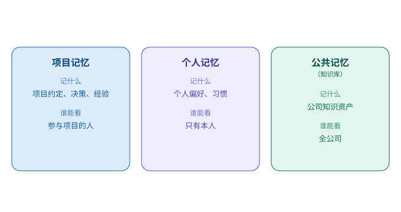

# 第 5 章　把对话，变成「记得住的事」

> 第一部分 · 智力。这一章讲：agent 怎么「记住有价值的东西」——记住的秘诀，不是「全都记」，而是「记对地方、舍得忘」。

---

## 一个「记性很好，但什么都忘」的悖论

上一章我们聊到，模型是「金鱼脑」，连一次对话都接不上，全靠系统帮它记上下文。

现在，想象你把这个「记上下文」的问题解决了——小 A 终于能跟你把一次对话好好聊完了。可新的问题又来了。

你花了一个下午，跟小 A 一起把一个复杂项目的需求理清楚了：目标是什么、踩过哪些坑、哪些方案被否了、最后定了什么。你们聊得很顺。然后，小 A 下班了。

**第二天，你来找他继续，发现他全忘了。**

不是「接不上话」——你们新开一次对话，他答得挺利索。但**昨天聊出来的那些「结论」，他一条都不记得了。** 你只能从头再讲一遍。

问题出在哪？出在：**一次对话的上下文，是「一次性」的。** 对话一结束，那本账就合上了。下次再来，又是一本新账，从零开始。

所以，光会「记住一次对话」还不够。一个靠谱的同事，还得会**把这次对话里「有价值的东西」记下来，变成下次还能用的「记忆」**。

这就是「记忆沉淀」。这一章，讲的就是它。

---

## 什么该记，什么不该记

先回答第一个问题：**一次对话里，什么值得「沉淀」下来？**

答案是——**不是全部，而是「结论」和「约定」。**

- 你明确说过、且反复强调的**偏好**（「以后报价都用人民币」「图表统一用红色表示上涨」）；
- 你们一起定下的**决策**（「这个方案定了，走方案 B」）；
- 项目里长期有效的**背景**（「这个客户是 5 年老客户，价格敏感」）；
- 值得复用的**经验**（「上次这个接口超时，是因为……后来用重试解决了」）。

而这些东西**不值得**沉淀：

- 一次性的寒暄（「今天天气不错」）；
- 过程中的自言自语（模型中间「想了什么」）；
- 已经被推翻的旧结论（「之前以为用 A，后来改成 B 了」，那就只记 B）。

一句话：**记「结论」，不记「过程」；记「约定」，不记「寒暄」。**

---

## 记在哪，谁能看

第二个问题：**这些记忆，记在哪？谁能看？**

这就要说到一个很关键的设计——**记忆是分级的**。一个企业级的 Agent，记忆大致分三个「抽屉」，边界清晰，各管各的：

| 记忆 | 记什么 | 谁能看 | 打个比方 |
|---|---|---|---|
| **项目记忆** | 这个项目/这场协作里定下的约定、结论 | 参与这个项目的人 | 项目里的「交接文档」 |
| **个人记忆** | 这个用户自己的偏好、习惯 | 只有这个用户 | 这个人的「私人笔记本」 |
| **公共记忆（知识库）** | 公司级的、大家都能用的知识资产 | 全公司 | 公司的「家底 / SOP 手册」 |

为什么一定要分开？因为**「谁能看」这件事，是安全的分界线。**

- 一个人的**隐私偏好**，不能让全公司都知道；
- 一个**项目的内部结论**，不能泄露给项目外的人；
- 只有**公共的知识**，才应该对所有人开放。

如果不分抽屉、全混在一起，那要么是「该藏的藏不住」（隐私泄露），要么是「该共享的共享不了」（每个人都在重复造轮子）。

**记忆分级，本质就是「给不同的记忆，配不同的锁」。** 这件事，我们在后面的「边界」和「治理」两部分，还会反复遇到。

---

## 记多了，会「膨胀」，所以要「舍得忘」

第三个问题，也是最反直觉的一个：**记忆记多了，也会坏事。**

你可能会想：记忆不是越多越好吗？

不是。记忆会**膨胀**。今天记一条，明天记两条，日积月累，记忆库越来越大。问题就来了：

- **越记越慢**：每次要用的时候，得在一大堆记忆里翻，翻得越多越慢；
- **越记越乱**：新旧记忆会冲突（「你之前说用红色，后来又改口用绿色」），模型看了反而糊涂；
- **越记越贵**：记忆是要「喂给模型看」的，喂得越多，token 越贵。

所以，「记得住」的高手，反而懂得**「舍得忘」**。

这里的巧思是：**工作总结式压缩。** 就像员工每周写一份工作总结——把这一周干的一堆琐事，压缩成三条「这周做了什么、学到什么、下周要注意什么」。**把「流水账」压成「经验值」，旧的过程可以丢，提炼出的结论必须留。**

这也呼应了上一章「会议纪要」的思路：**真正的记忆，不是「把所有东西都存起来」，而是「把有价值的东西提炼出来」。**

---

## 巧思：先记账，再干活

最后，讲一个贯穿全书、但很多人第一次听会愣一下的巧思——**「先记账，再干活」**。

直觉告诉我们：一件事应该「先干完，再记录结果」。对不对？

但企业级 Agent 反着来：

> **先把「我要干这件事」记下来，再去干。**

为什么要反着来？因为你要对付的是**「意外」**：

- 模型干到一半，进程崩了；
- 用户等不及，关掉了页面；
- 网络断了，后面没下文了。

如果「先干完再记」，那这些意外一发生，你就**什么都没有**——它干了啥、干到哪一步，全成了糊涂账，没法还原、没法续、没法追责。

但如果你**先把「我要干这件事」记下来**，再去干——那不管后面发生什么，账本上都留着一笔「这件事开始了、要干什么」。从这一笔出发，你就能还原出「当时到底发生了什么」。

**账，永远比活先落。** 这八个字，是这本书里最重要的操作原则之一。它和「两本账」一起，构成了企业级 Agent 可靠性的地基。

---

## 这一章，你只要带走三句话

1. **记「结论」，不记「过程」**——沉淀的是「约定」和「决策」，不是寒暄和流水账；
2. **记忆分三个抽屉**——项目、个人、公共（知识库），边界清晰，谁能看配谁的锁；
3. **舍得忘，才记得久**——工作总结式压缩，把「流水账」压成「经验值」；先记账再干活，账永远比活先落。

到这里，「智力」这一部分的三件事——**怎么想、怎么记、怎么沉淀**——就讲完了。脑子的问题解决了，接下来该给这个「聪明的新同事」长出手脚了。

下一部分，**能力**——它是怎么「做成事、说清话」的。

---

> 本章配图（已产出，存于 assets/）：
> - 图 5-1　示意图：fig-5-1-memory-levels.svg（记忆分三个抽屉）
