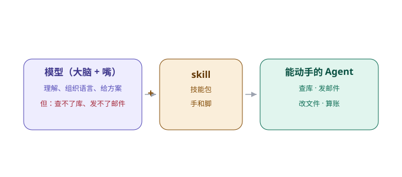

# 第 6 章　技能包：把能力装进去

> 第二部分 · 能力。这一章讲：agent 凭什么「做得成事」——答案是 skill，它给模型装上了「手和脚」。

---

## 一个「很会说，但什么都做不了」的天才

想象你招了一个口才极好的新同事小 A。他能写出一篇漂亮的方案，能把一个复杂的概念讲得头头是道，你跟他聊天，如沐春风。

但你很快发现一个大问题：**他只会「说」，一件事都「做」不了。**

你跟他说：「帮我把这个月的销售数据汇总一下，发个邮件给老板。」他点点头，然后开始**长篇大论地跟你讲**「汇总销售数据的意义、方法、以及注意事项」——但他既不打开你的数据库，也不发邮件，甚至不打开电脑。

你问：「你倒是去查数据啊？」他一脸无辜：「我不会啊。我只能告诉你『应该怎么做』，做，得你自己来。」

**这就是一个「没有 skill 的模型」。**

大语言模型天生就会「说」——它理解、它组织语言、它给出方案。但它天生不会「做」——它查不了数据库、发不了邮件、改不了文件、算不了账。它是个「只有嘴、没有手脚」的天才。

让这个天才真正「能干活」的，就是 **skill（技能包）**。

---

## skill 到底是什么

一句话：**skill，就是「让模型能动手」的一个个能力模块。**

你可以把它理解成给模型配的一套「工具 + 使用说明」。一个 skill，通常包含两样东西：

1. **它「会干什么」**——一段清楚的描述，告诉模型「你有这么一个能力，它适合在什么情况下用」；
2. **它「怎么用」**——这个能力背后真正干活的逻辑，以及调用它需要哪些参数。

举个最朴素的例子，一个「查数据库」的 skill：

- **描述**：「当用户需要查询业务数据时，调用这个工具，传入要查询的内容」；
- **逻辑**：背后是一段真正会去连数据库、执行查询、返回结果的代码。

模型在对话时，看到用户问「这个月卖了多少」，它就会**自己判断**：「这件事，我该用『查数据库』这个 skill。」然后调用它，拿到结果，再用自己的语言组织成一句人话回给用户。

**模型负责「想」和「说」，skill 负责「做」。** 两者配合，这个「天才」才算长出了手脚。

---

## 为什么 skill 要「可发现、可描述、可校验」

现在，一个很实际的问题来了：模型怎么知道「自己有哪些 skill，什么时候该用哪个」？

你不可能让模型「记住」你给它装了多少个 skill——它记不住，而且 skill 会越来越多。所以，skill 的**管理方式**，就变得至关重要。

这里藏着这一章的巧思：

> **skill 要「可发现、可描述、可校验」——不是越多越好，而是每个都清清楚楚。**

具体是三件事：

**① 可发现（discoverable）。**
模型要知道「我有哪些能力」。这靠的是一份「能力清单」——每个 skill 的一段简短描述，会实时地、按需地提供给模型。模型一看清单，就知道「哦，我能查库、能算账、能生成图表、能改文件」。没有这份清单，模型就不知道自己会什么，等于白装。

**② 可描述（describable）。**
每个 skill 要**说清楚自己「是干什么的、什么时候用、传什么参数」**。描述得越准，模型用起来越不容易「张冠李戴」——该查库的时候去查库，该算账的时候去算账，而不是乱用一气。

**③ 可校验（verifiable）。**
每个 skill 的输入输出要**能被检查**。它接收什么格式、返回什么格式，要清清楚楚。这样模型用错了、或结果不对，系统能及时发现，而不是让它「一本正经地把错结果说给你听」。

你可能觉得这些是「细节」，但恰恰是这些细节，决定了一个 agent 是「能用」还是「乱用」。

---

## 一个 skill，一个职责

除了「可发现、可描述、可校验」，还有一个原则，很多人会忽略：

> **一个 skill，只做一件事。**

为什么？因为 skill 越多、越杂，模型越容易「用错」。这跟写代码里的「单一职责」是一个道理：

- 「查数据库」是一个 skill，「算统计」是另一个 skill，「生成 PPT」又是另一个。各管一摊，边界清晰。
- 反过来，如果你搞一个「万能 skill」——既能查库、又能算账、还能改文件——模型面对一个模糊的请求时，就不知道该不该用它、用了之后会干出什么来，出错的风险大大增加。

**把能力拆成一个个「小而专」的 skill，而不是堆一个「大而全」的工具**，这是让 agent 从「能跑」到「能用」的关键一步。

---

## 能力，要「装得进去」，也要「查得出来」

最后补一句：skill 不是「装完就完了」。

一个企业级 agent，能力会越装越多——几十个、上百个 skill 都很正常。这时候，一个新的问题冒出来：**模型面对一百个 skill，怎么在需要的时候，快速找到「最对的那一个」？**

这就涉及「能力的发现与检索」——也就是后面「工具搜索」那部分内容。核心思路是：**不把一百个 skill 全塞给模型，而是按需、按关键词，只把「最可能用得上」的那几个挑出来给它。**

这跟「记忆要分级」「上下文要精简」是同一个道理：**不是越多越好，是「越对、越聚焦越好」。**

---

## 这一章，你只要带走三句话

1. **模型只会「说」，不会「做」；skill 就是它的手和脚**——让模型「能动手」的能力模块；
2. **skill 要可发现、可描述、可校验**——每个都清清楚楚，模型才不会乱用；
3. **一个 skill 一个职责**——小而专，而不是大而全；能力多了，还要会「按需检索」。

skill 解决了「自己的手脚」。但企业干活，还得会用「外面的工具」——别人的数据库、别人的系统、别人的接口。这些五花八门的外部接口，agent 怎么统一调用？

这就是下一章——**API 转 MCP**。

---

> 本章配图（已产出，存于 assets/）：
> - 图 6-1　示意图：fig-6-1-skill-hands.svg（skill：模型的手和脚）
