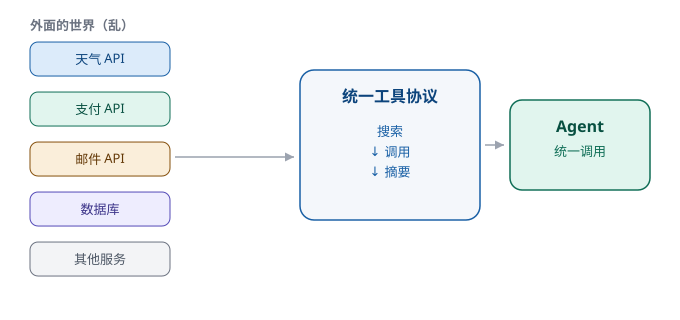

# 第 7 章　别人的 API，变成自己的工具

> 第二部分 · 能力。这一章讲：agent 怎么调用「外面的世界」——把五花八门的外部接口，收拢成一套统一的「工具协议」。

---

## 一个「插座都插不上」的办公室

上一章说，skill 让模型长出了手脚。现在想象：你的公司要跟外面的世界打交道。

公司的「工具房」里，摆满了各种电器的插头：有的插头是两脚的，有的是三脚的，有的是圆孔，有的是扁孔，还有的电压是 110 伏、有的是 220 伏。你想让这些电器都接上电，结果发现——**每个电器都要配一个专门的转换头。**

更麻烦的是，这些「电器」还在不断换新款：今天这个系统升级了接口，明天那个平台改了调用方式。你辛辛苦苦给每台电器配的转换头，过两天就报废了。

**外部世界的 API（接口），就是这么个状况。**

每个公司、每个平台、每个 SaaS 服务，都有自己的接口：格式不一样、调用方式不一样、返回结果的结构不一样、鉴权方式也不一样。你让 agent 去「调用外面的世界」，如果每接一个接口都要单独写一套「对接代码」，那既累、又脆、还维护不过来。

这一章，就讲怎么把这个乱糟糟的局面，收拾干净。

---

## 问题出在哪：接口的「方言」太多

先把问题说清楚。让 agent 调用外部接口，难在哪？

难的不是「调用」本身，而是**「统一」**：

- **鉴权方式不一样**：有的要 API Key，有的要 OAuth，有的要签名；
- **参数格式不一样**：有的用 JSON，有的用表单，有的字段名还天天变；
- **返回结构不一样**：有的返回一个数组，有的包了一层又一层的 `data`；
- **文档质量不一样**：有的文档清清楚楚，有的文档一言难尽。

如果 agent 每调一个外部接口，都要「人肉」去适配这些差异，那这个 agent 的可扩展性就毁了——接一个接口还好，接一百个接口，就是一场噩梦。

---

## 巧思：把散落的 API，收拢成一套统一的「工具协议」

解决思路，其实很朴素：

> **别让 agent 去适配一百种接口，而是把一百种接口，都「翻译」成同一种「工具」给 agent 用。**

具体怎么做？核心是两步：

**第一步：收拢。** 把外部五花八门的 API，**登记、封装**成一个个标准的「工具」。每个工具，不管背后是什么接口，都对外暴露成**同一个样子**——统一的「它叫什么、能干什么、传什么参数、返回什么结果」。

**第二步：翻译。** agent 只认这一套统一的样子。它调用「查天气」这个工具时，根本不用管背后是哪个天气平台的接口、鉴权是怎么做的——这些「脏活累活」，都在工具的**内部**被翻译、被处理掉了。

这套「统一的工具协议」，就是让 agent 能「一视同仁」地调用整个外部世界的关键。**外面再乱，对 agent 来说，都是一排整整齐齐的、可随时调用的工具。**

---

## 三步走：搜索、调用、摘要

光「收拢」还不够。外部接口那么多，agent 面对成百上千个工具，怎么「找到对的、用对、并看懂结果」？这里有一套清晰的「三步走」：

| 步骤 | 做什么 | 解决什么问题 |
|---|---|---|
| **① 搜索（search）** | 按关键词，从一堆工具里挑出「最可能用得上」的那几个 | 工具太多，不能全塞给模型 |
| **② 调用（call）** | 把挑中的工具，用正确的参数真正执行一次 | 找到还不够，要「真做」 |
| **③ 摘要（summary）** | 把工具返回的原始结果，整理成人能读懂的结论 | 返回结果往往是「一坨」，要提炼 |

我们一层层看：

**搜索**——还记得上一章「能力要可发现」吗？到了「外部 API」这个量级，「可发现」就更重要了。成百上千个工具，你不能全堆给模型（它读不过来、还会挑花眼）。所以要先**按需搜索**：用户问「查一下明天的天气」，系统就从工具库里，把「天气」相关的工具挑出来，而不是把一千个工具全倒给它。

**调用**——挑中了，就真的去执行一次。这一步要处理参数、鉴权、超时、重试这些「脏活」——都是工具内部的事，agent 不用操心。

**摘要**——工具执行完，往往返回一大坨原始数据（JSON、日志、表格）。你不能把这坨东西原样甩给用户。要先**摘要**，把关键信息提炼出来，再由模型组织成人话。这跟前面「会议纪要」「工作总结式压缩」是同一个精神：**过程可以复杂，结论必须清楚。**

**搜索 → 调用 → 摘要**，三步环环相扣，把「外面很乱」这件事，对 agent 藏得干干净净。

---

## 为什么这很重要：可扩展，才可持续

你可能想问：搞这么一套「统一协议」，值得吗？

答案是：**非常值得，因为它决定了你的 agent 能不能「长大」。**

一个只能调用「写死的几个接口」的 agent，和一个「能随时接入任何接口」的 agent，是两种完全不同的东西：

- 前者，每接一个新接口，都要改一次代码、重新部署一次，越接越慢，最后没人愿意再接了；
- 后者，接一个新接口，只是在工具库里**登记一条新的工具**，agent 立刻就能用了，越接越快，公司的「外部能力」像滚雪球一样越滚越大。

**「统一」这件事，看起来是「前期多花点功夫」，实际是「后期省下无数功夫」。** 这正是企业级系统和 demo 级系统的分水岭之一。

---

## 这一章，你只要带走三句话

1. **外部接口是「方言」——格式、鉴权、返回五花八门，agent 不能一个个去适配**；
2. **把散落的 API 收拢成一套统一的「工具协议」**——外面再乱，对 agent 都是一排整齐可调的工具；
3. **搜索 → 调用 → 摘要，三步走**——先找到对的、再真做、最后把结果讲清楚。

能力到了这一步，agent 已经「能说、能做、还能调用外面的世界」了。但它还只会「打字」——听不见、看不着。一个只能打字的同事，和那个「面对面」的世界之间，还隔着一堵墙。

下一章，就拆这堵墙——**多模态**。

---

> 本章配图（已产出，存于 assets/）：
> - 图 7-1　示意图：fig-7-1-api-to-mcp.svg（把散落的 API 收拢成一套工具协议）
