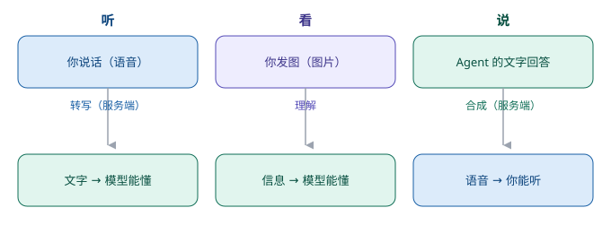

# 第 8 章　听见、看见、说出来

> 第二部分 · 能力。这一章讲：agent 怎么「听」「看」「说」——以及为什么「听写」这件事，比想象中难得多。

---

## 一个「只能打字」的同事

到目前为止，小 A 已经是个很能干的同事了：他会想、会记、会调用工具、会查外面的数据。

但他有一个毛病：**他只会「打字」。**

你给他发一段语音，他「听」不见；你甩给他一张截图，他「看」不着；你想让他用嘴把结论念给你听，他「说」不出来。

**他只能活在那个「打字的聊天框」里。** 而真实的世界，是声音、是图像、是面对面。

想象一下：你在开车，腾不出手打字，只想用嘴说一句「帮我把今天的会议纪要找出来念给我听」。如果 agent 只能打字，这件事就做不了——你得停下车、打开手机、一个字一个字地敲。

这就是为什么「多模态」这么重要：**它把 agent 从「聊天框」里解放出来，让它能进入真实世界的多感官交互。** 这一章，就讲「听、看、说」这三件事。

---

## 听：让 agent 听懂你说的话

「听」，是指把你说的话（语音），变成文字，让 agent 能理解。这件事的专业叫法，叫**语音转写（ASR，自动语音识别）**。

你可能会觉得：「现在语音识别不是很成熟了吗？手机上的语音输入不是挺好用的吗？」

对，但那是「手机本地、离线的、一次性说完」的场景。**企业级 agent 的语音，要难得多**：

- **要「边说边转」**：你不能等用户把一分钟的话全说完才开始处理，要**边说边出字**，像直播字幕一样实时滚出来；
- **要处理「长语音」**：一句话可能说一分钟、两分钟，中间不能断；
- **要支持各种环境**：用户在办公室、在车上、在嘈杂的会议室，背景音、口音、语速，千差万别。

这些难点，归结成一句话：**「听写」这件事，比想象中难得多。**

---

## 巧思一：把重活放到服务端，前端只负责「收声音」

面对「听写」的复杂度，一个关键的设计决策是：**分工。**

> **前端只干一件轻活——把声音收下来、传上去；真正的「转写」重活，全部放到服务端去做。**

为什么要这么分？

因为「语音转写」是个**又重又吃资源**的活：要加载识别模型、要占用大量计算、要处理各种音频格式。如果把它压在用户的浏览器（前端）里跑，会出现一堆问题：

- 用户的设备性能参差不齐，有人卡、有人崩；
- 识别模型动辄几十上百兆，每次都要下载，又慢又费流量；
- 升级识别模型，得让每个用户都更新一次前端，麻烦得很。

所以更聪明的做法是：**前端只做「收声音」这一件小事，把声音分片传上去；服务端统一负责「转写」，再把结果一句句推回来。** 这样，识别模型的升级、调优、加资源，全在服务端统一搞定，用户无感。

这跟很多企业系统的思路一脉相承：**把「重活、脏活、要统一管理的活」往服务端收，把「轻活、跟用户交互的活」留在前端。**

---

## 看：让 agent 看懂你发的图

「看」，是指让 agent 理解你发的**图片**——截图、照片、图表、文档扫描件。

这件事相对「听」要简单一些，因为它本质上是把图片「翻译」成文字描述，再交给模型理解。但它也有自己的讲究：

- 你发一张**截图**，agent 要能认出里面的关键信息（报错提示、表格数据、界面布局）；
- 你发一张**表格照片**，agent 要能把它还原成结构化的数据，而不是「大概看个意思」；
- 你发一份**扫描的合同**，agent 要能提取里面的条款。

「看」的核心价值在于：**让 agent 能处理那些「说不清、只能用图表达」的信息。** 一张截图，胜过千言万语。

---

## 说：让 agent 把话「念」出来

「说」，是指把 agent 的文字回答，转成语音念给你听（TTS，语音合成）。

这件事的巧思，恰好和「听」反过来：

- 「听」是把**重活放服务端**；「说」也类似——文字转语音的模型，同样放服务端，前端只负责「播放」；
- 但「说」还有一个额外的讲究：**要配合「流式」**。agent 是「边说边想」的，你不能等它把整段话都生成了才去念，那样用户要等很久。最好是**生成到哪，就念到哪**，边生成边播。

「听、看、说」三件事合起来，agent 才真正「进入」了真实世界：**你用嘴说，它用耳听；你发图，它用眼看；它用嘴，把结论念给你。**

---

## 巧思二：不支持，就优雅降级

最后一个巧思，是关于「边界」的——但它属于能力的范畴，因为决定了一个功能「能不能用」。

> **当环境不支持某样能力时，别硬来，优雅地降级。**

举个最常见的例子：**语音输入需要「安全上下文」**（比如 HTTPS 的加密连接）才能访问设备的麦克风。如果用户通过一个「不安全的地址」（比如直接访问一个 HTTP 的 IP 地址）打开页面，浏览器根本不会给你麦克风权限——`麦克风` 这个能力直接就是「没有」。

这时候，聪明的做法不是报错、也不是硬要调用，而是：

- **提前检测**「这个环境支不支持语音」，支持，就正常显示「语音输入」按钮；
- **不支持，就优雅地降级**：把按钮置灰，并且告诉用户「当前环境不支持语音输入，请用文字」，而不是让用户点下去才发现坏了。

**「能用的时候用得爽，不能用的时候不添乱」**——这就是优雅降级。它背后是一个朴素的道理：**一个靠谱的能力，不能只在「理想环境」下靠谱，还得在「不理想的环境」下，也不让人抓狂。**

---

## 这一章，你只要带走三句话

1. **多模态，让 agent 从「聊天框」走进真实世界**——听、看、说，三件事都补上；
2. **「听写」比想象中难，重活放服务端、前端只收声音**——边说边转、长语音、环境嘈杂，都要在服务端统一扛；
3. **不支持，就优雅降级**——能用的时候用得爽，不能用的时候不添乱。

能力讲到这里，agent 已经「会想、会做、会调用外部世界、能听能看能说」了。但还有一个致命的问题没解决：**它在「黑盒」里干了这么多事，人怎么看？怎么信？**

下一章，就把这个「黑盒」打开——**UI 与交互**。

---

> 本章配图（已产出，存于 assets/）：
> - 图 8-1　示意图：fig-8-1-multimodal.svg（多模态：听、看、说）
