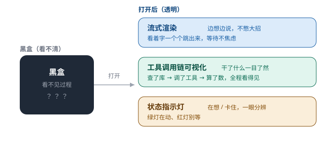

# 第 9 章　把想法，画给你看

> 第二部分 · 能力。这一章讲：agent 在「黑盒」里干了那么多事，人怎么看、怎么信——答案是把「看不见的过程」，变成「看得见的界面」。

---

## 一个「关起门来干活」的同事

想象你让小 A 去办一件事：查一下这个季度的销售数据，做个分析，写份汇报。

然后，他**转身进了办公室，关上了门**。你在外面等。

一个小时过去了，没动静。两个小时，还是没动静。你不知道他是在认真干活，还是卡住了，还是偷偷睡着了，还是早就干完、在等你进去。

你等得心慌，忍不住敲门：「怎么样了？」里面传来一句含糊的：「快了快了。」

**这种「关起门来干活」的体验，就是很多 agent 给用户的感受。**

agent 干的事，本质是一个「黑盒」：你输入一句话，它经过一堆看不见的思考、调用、计算，最后输出一个结果。中间发生了什么——它查了什么库、调了什么工具、想了什么、卡在哪——你**一概看不见**。

问题在于：**看不见，就信不过。** 一个你完全看不见过程的系统，你没法信任它的结果——它说「分析完了」，你怎么知道它是真的分析了，还是随手编了一个？

这一章，就讲怎么把这个「黑盒」打开，让 agent 的「想法」，透明地画给你看。

---

## 巧思一：流式渲染——「边想边说」，而不是「憋大招」

第一个打开黑盒的动作，叫**流式渲染**。

回想一下：agent 回答你的时候，它其实是**一个字一个字「想」出来的**（我们在第 4 章提过流式输出）。那用户这边，应该怎么呈现？

两个选择：

- **憋大招**：等它把整段话都「想」完了，再一次性显示出来。结果是——你盯着一个空白的界面，傻等十秒、二十秒，心里发毛；
- **边想边说**：它想出一个字，你就看到一个字的进度。就像跟人聊天，对方「嗯……这个数据，我们看，嗯……」——你虽然还没听到结论，但你知道**他在想、在说、没卡住**。

显然，「边想边说」的体验好得多。它带来一个心理上的巨大变化：

> **等待，从「一片空白」变成「有东西在动」。**

同样是等五秒，看一片空白，和看字一个个跳出来，是两种完全不同的感受。前者让人觉得「是不是坏了」，后者让人觉得「它在努力」。

**流式渲染，就是把「等待」这件本来很焦虑的事，变成「看着它在干活」这件让人安心的事。**

---

## 巧思二：工具调用链可视化——把它「干了什么」透明地画出来

流式渲染解决了「它是不是在说话」。但还有更深的一层：**它在说话之前，到底「干了什么」？**

一个 agent 回答你「这个季度销售额增长了 15%」之前，背后可能做了一连串动作：

1. 它先判断「你想查销售数据」；
2. 它调用了「查数据库」的工具；
3. 它又调用了「算统计」的工具；
4. 它把两个工具的结果综合起来，才得出「增长 15%」这个结论。

如果这些动作你全都看不见，那你就会怀疑：「这 15% 是它真算出来的，还是它随口编的？」

所以有了**工具调用链可视化**：

> **把 agent 调用了哪些工具、每一步做了什么、返回了什么，像「流程图」一样透明地展示出来。**

你一眼就能看到：「哦，它先查了库 → 又算了数 → 最后才得出这个结论。」这一条清晰的链条，就是**信任的来源**——结论不是我凭空给你的，而是我一步步做出来的，你看得见。

这跟「企业里干完活要交底」是一个道理：**一个靠谱的员工，不仅给你结果，还能告诉你「我是怎么得出这个结果的」。**

---

## 巧思三：状态指示灯——「在想」和「卡住了」，要一眼分辨

流式渲染 + 工具链，解决了「过程透明」。但还有一个更基础的问题：**它现在到底「活着没有」？**

很多 agent 界面，你发完一句话，就进入漫长的等待。这时候，你脑子里会冒出一个念头：**「它是不是卡住了？」** 如果它真的卡住了，你还在傻等，那就是浪费时间。

所以有了**状态指示灯**：

> **用一眼能看懂的状态，告诉你 agent「现在是什么情况」——正在思考？正在调用工具？还是已经卡死/出错了？**

- 「正在思考」——绿灯闪烁，说明它在动；
- 「正在调用工具」——换个颜色，说明它在干活；
- 「卡住 / 出错」——红灯，你立刻就知道「别等了，有问题」。

这跟企业里「看板上的进度灯」一模一样：**绿灯=正常，黄灯=在忙，红灯=有故障。** 一眼扫过去，就知道「该不该等、要不要干预」。

**「在想」和「卡住了」，用户是分不出来的——除非你用一盏灯把它区分开。** 这盏灯，就是信任的最后一公里。

---

## 走出 Web：把对话，带进企业聊天工具里

最后，还有一件很容易被忽略的事：**对话界面，不能只在网页里。**

想象一下：你的同事们，天天用的是飞书、企业微信这些聊天工具。如果 agent 只能在一个专门的网页里用，那意味着**每次想找它，都得专门打开一个网页、重新登录**——这个门槛，足以劝退一半的人。

所以，一个真正「好用」的企业级 agent，会**走进企业的聊天工具**（比如飞书 IM）：

- 在飞书里，你直接 @ 它，它就能回你；
- 它处理的结果，直接以消息的形式发给你；
- 你甚至不用「登录」——因为你在飞书里的身份，就已经证明了你「是谁」。

这一步的价值在于：**把 agent 从「一个要去的地方」，变成「一个随时在身边的同事」。** 它不再是「我专门去找的一个工具」，而是「我随手就能 @ 一下的一个人」。

**对话界面的终极形态，不是「更漂亮的网页」，而是「消失在用户熟悉的工具里」。**

---

## 这一章，你只要带走三句话

1. **看不见，就信不过**——agent 是黑盒，把它打开，是赢得信任的前提；
2. **三个巧思，把黑盒变成透明**——流式渲染（边想边说）、工具调用链可视化（干了什么一目了然）、状态指示灯（在想还是卡住，一眼分辨）；
3. **走出 Web**——把对话带进企业聊天工具，让 agent 从「一个要去的地方」，变成「一个随时在身边的同事」。

到这里，「能力」这一部分的四件事——**skill、API 转 MCP、多模态、UI**——就讲完了。这个「新同事」已经既能想、又能做、还能表达。但一个人再能干，也干不完所有活——它得学会「跟别人一起干」。

下一部分，**协作**。

---

> 本章配图（已产出，存于 assets/）：
> - 图 9-1　示意图：fig-9-1-ui-transparency.svg（把黑盒打开：流式 + 工具链 + 指示灯）
