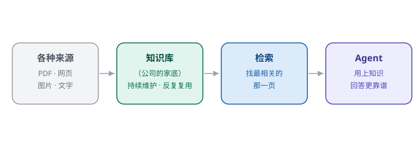

# 第 10 章　把知识，攒成公司的家底

> 第三部分 · 协作。这一章讲：agent 怎么用「公司的知识」——知识库不是临时翻的手册，而是越攒越值钱的「家底」。

---

## 一个「每来一个新人，都要从头教一遍」的公司

想象一个让人头疼的场景。

你们公司有个老员工老王，干了十年，什么坑都踩过、什么门道都门儿清。可问题是——**这些经验，全在他一个人的脑子里。**

新人小李来了，问「这个客户的报价，一般怎么定？」——没人能答，得去把老王从会上拽出来。老王讲一遍，小李记半遍，下次小李又忘了，又得去问老王。

最要命的是：**老王有一天离职了。** 他一走，十年攒下的经验，一夜之间清零。公司像被掏空了一样，一切都要从头再来。

你发现问题了吗？——**知识如果只存在「人」的脑子里，它是会「丢」的。** 人会离职、会遗忘、会忙得没空教新人。

所以，一个成熟的公司，一定会做一件事：**把知识「攒」下来，变成公司的「家底」**——写成 SOP（标准作业流程）、整理成文档、沉淀成案例库。这样，老王走了，他的经验还在；小李来了，不用从头教，照着 SOP 干就行。

**知识库，就是给 agent 配的这份「公司的家底」。**

---

## 知识库，不是「临时翻的手册」

这里要先纠正一个常见的误解：**知识库 ≠ 搜索引擎，也不等于「一堆文档堆在那」。**

很多人以为，知识库就是「把一堆 PDF、网页、文档存起来，agent 用的时候去搜一搜」。但这么理解，就把它看小了。

真正的知识库，是**「公司的知识资产」**。它的定位，跟「专利」「客户名单」「SOP 手册」是一个级别的：

- 专利，是公司「技术」的资产；
- 客户名单，是公司「关系」的资产；
- **知识库，是公司「经验」的资产。**

资产有两个特点，普通文档没有：

**① 资产要「持续维护」。** 一份 SOP，不是写完了就万事大吉，而是要随着业务变化，不断更新。过时的知识，比没有知识更危险——它会误导 agent，让它拿着三年前的流程去处理今天的事。

**② 资产要「反复复用」。** 一份真正好的知识，应该被无数人、无数次地反复使用，而不是躺在角落里吃灰。用得越多，它的价值越大；反过来，越是被反复使用、反复验证的知识，越值得信任。

所以，知识库的本质是：**把散落在人脑子里、文档里的「经验」，沉淀成公司能反复复用的「资产」。**

---

## 检索，不是「关键词匹配」，而是「找最相关的那一页」

agent 怎么用这份家底？靠**检索（RAG，检索增强生成）**。

这里有一个很多人会踩的坑：**以为「检索」就是「关键词搜索」。**

不是。关键词搜索是「精确匹配」——你搜「销售」，它就把所有含「销售」两个字的文档都找出来。但真实的问题往往更模糊：

- 你问「上季度我们卖得怎么样」，文档里可能根本没出现「卖得怎么样」这几个字，但有一篇叫「Q3 销售回顾」的报告，才是你要的答案；
- 你问「客户退单了怎么处理」，文档里可能写的是「售后与退货流程」，字面上对不上，但意思完全相关。

**真正的检索，不是「找含关键词的文档」，而是「找语义上最相关的那一页」。**

它是怎么做到的？核心是「向量检索」：把每一段知识，都转成一个「语义的坐标」（向量），把你问的问题，也转成一个「语义的坐标」，然后**找坐标上「离你最近」的那段知识**。

打个比方：关键词匹配，像在一个图书馆里「按书名精确找书」；向量检索，像问一个资深图书管理员「我想了解 X 相关的内容」，他能凭「理解」，从一堆看似不相关的书里，抽出真正对你有用的那一页。

**「找最相关的那一页」，而不是「找含关键词的那几页」**——这是知识库能不能真正帮上忙的关键。

---

## 知识，要「进得来、出得去、管得住」

一个能用的知识库，光「能检索」还不够。它还得解决三件事：

| 环节 | 要解决什么 | 一句话 |
|---|---|---|
| **进得来** | 知识怎么入库？PDF、网页、图片、文字，各种来源都要能收 | 来源五花八门，都能收进来 |
| **出得去** | 检索到的知识，怎么喂给模型？ | 只喂「最相关的那一页」，不喂一堆 |
| **管得住** | 谁能看、谁能改、谁能删？权限要管住 | 知识也分级，该保密的保密 |

**「进得来」**——知识来源很杂：有人上传 PDF，有人贴一个网页链接，有人直接写一段文字。好的知识库，要能把这些「乱七八糟」的来源，统一地「吃」进来、整理成结构化的知识。这跟第 7 章「把散落的 API 收拢成协议」是同一个思路：**来源可以乱，入库要统一。**

**「出得去」**——检索到了，不能一股脑全塞给模型（又是「上下文要精简」的老道理）。要只把「最相关、最关键」的那几段喂给它，其余的先放一边。**给模型的知识，越精越好。**

**「管得住」**——知识也分三六九等：有的知识是公司的机密（配方、报价、未公开合同），有的知识是全公司共享的。权限管不住，知识库就会变成「泄密库」。这一点，我们在后面的「边界」和「治理」还会深入讲。

---

## 这一章，你只要带走三句话

1. **知识库是「公司的知识资产」，不是「临时翻的手册」**——要持续维护、反复复用，越攒越值钱；
2. **检索是「找最相关的那一页」，不是「关键词匹配」**——语义相关，才是真相关；
3. **知识要「进得来、出得去、管得住」**——来源统一收、只喂最相关的、权限要分级。

有了知识库，agent 就能「用公司的家底」了。但还有一个协作场景没解决：**有些活，它自己一个人干不了，得「找帮手」**——比如专业领域的问题，得让更专业的人来答。

这就是下一章——**子 agent 调用**。

---

> 本章配图（已产出，存于 assets/）：
> - 图 10-1　示意图：fig-10-1-knowledge-base.svg（知识库：越攒越值钱的家底）
