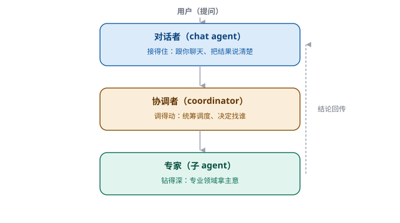

# 第 11 章　一个人干不完，就分工

> 第三部分 · 协作。这一章讲：agent 一个人干不完时，怎么「分工」——答案是让「专业的人，干专业的事」。

---

## 一个「既当医生，又当护士」的同事

想象一个糟糕的医院。

这个医院里，只有一个人——张三。他既要在门口接诊、给病人挂号，又要进手术室做手术，还要去药房抓药、去收费处收费，甚至连打扫卫生、修水管，都是他一个人干。

结果可想而知：他一会儿在手术台上，一会儿又被叫去修马桶。**手术做到一半，病人还躺在台上，他却跑去给人挂号了。** 什么都会一点，什么都干不好，还忙得焦头烂额。

你发现问题了吗？——**一个人「什么都要干」，等于「什么都干不好」。**

真实的医院是怎么做的？**分工**：有医生、有护士、有药师、有收费员、有保洁。每个人只干自己最专业的那一摊，互相配合。

**一个企业级 Agent，也会遇到「一个人干不完」的时候，它同样需要分工。**

---

## 什么时候，一个 agent 会「干不完」

先问：agent 不就是一个模型吗？它什么都能聊，为什么还要「分工」？

因为**「能聊」不等于「能聊好」**。真实场景里，一个 agent 要同时面对这些：

- 有的任务，要跟用户**好好聊天**，语气、节奏、追问，都要拿捏得当；
- 有的任务，要在后台**统筹调度**，安排多个活、协调多个工具；
- 有的任务，需要**专业领域的深度**——比如医学、法律、金融，这需要专门的知识和专门的「脑子」。

如果把这三件事，全塞给「一个大脑」同时干，就会出现「张三困境」：

- 它一边要照顾你的情绪，一边要调度一堆任务，一边还要装成金融专家——结果，聊天聊得生硬，调度乱成一团，专业问题答得似是而非。

**所以，分工的本质，是让「不同的事，用不同的『人』（或不同的 agent）去干」。**

---

## 巧思：对话者 / 协调者 / 专家，三层分工

企业级 Agent 里，一个非常经典的分工，是**三层**：

| 角色 | 干什么 | 打个比方 |
|---|---|---|
| **对话者**（chat agent） | 跟你聊天、理解你的意图、把结果好好地说给你听 | 前台 / 客服 |
| **协调者**（coordinator） | 在后台统筹调度，决定「这件事该找谁、怎么拆、怎么推进」 | 项目经理 / 主管 |
| **专家**（expert / 子 agent） | 在某个专业领域拿主意、干专业活 | 专科医生 / 专业顾问 |

我们来感受一下这三个角色是怎么配合的：

你问了一个专业问题：「帮我看一下这份合同，里面的违约责任条款，有没有对我们不利的地方？」

- **对话者**先接住你：它听懂你在问「合同审查」，态度温和地回你「好的，我来帮您看看这份合同」；
- **协调者**在后台判断：这活儿太专业了，得找「法律」方向的专家来干；
- 于是，一个「法律专家」子 agent 被调出来，专注地分析这份合同的条款，给出专业意见；
- 最后，**对话者**再把专家的结论，翻译成你听得懂的人话，好好地说给你。

**「接得住」的归对话者，「调得动」的归协调者，「钻得深」的归专家。** 各管一摊，谁都不越位。

---

## 子 agent 的妙处：把「专业」装进「一次性」的临时工

这里有个很妙的细节，值得单独说。

这些「专家」子 agent，不是常驻的、独立的「员工」，而是**「按需召唤、用完即走」的临时工**：

- **按需召唤**：平时没有这个「专家」，只有当你问到了专业问题，协调者才临时「叫」一个出来；
- **专注一事**：这个子 agent 被叫出来的唯一目的，就是把「这一件专业的事」干好，别的它不管；
- **用完即走**：干完了，把结论交回来，这个子 agent 就「下班」了——它那段「干活的过程」，用完即弃。

你可能会问：那它干的「活」呢？会不会白干？

不会。这里有一个很聪明的安排：

> **子 agent 的「过程」是临时的，但它的「成果」是留给你的。**

打个比方：你请了个临时工来帮你整理文件。他来了，忙活了一下午，中间的过程（他怎么分类、怎么想的、翻过哪些废纸）你不在乎。但他**整理出来的那一摞文件**，是实实在在放在你桌上的成果。

子 agent 也一样：**它「想的过程」用完即弃，但它「产出的成果」——比如一份合同审查意见、一个生成好的文件——会留在你（主 agent）的「工作台」上，你随时能用。**

**「过程可弃，成果必留」**——这就是子 agent 分工的精妙之处：既得到了专业能力，又不让系统被一堆临时工的历史包袱拖累。

---

## 这一章，你只要带走三句话

1. **「什么都要干」，等于「什么都干不好」**——一个人干不完的活，就要分工；
2. **三层分工**——对话者（接得住）、协调者（调得动）、专家（钻得深），各管一摊；
3. **子 agent 是「按需召唤、用完即走」的临时工**——过程可弃，成果必留。

分工解决了「怎么一起干」。但还有一个「协作」里最实际的问题没讲：**有些活，不是「马上就能干完」的**——要跑几分钟、甚至几十分钟。用户不可能干等着。

这些「要等一等的活」，怎么管？这就是下一章——**task 调度**。

---

> 本章配图（已产出，存于 assets/）：
> - 图 11-1　示意图：fig-11-1-three-roles.svg（三层分工：对话者 / 协调者 / 专家）
