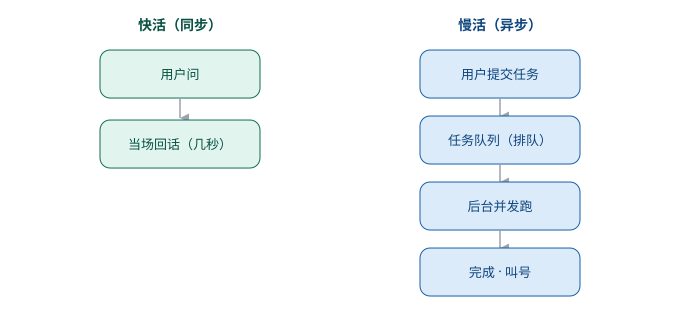

# 第 12 章　那些要等一等的活

> 第三部分 · 协作。这一章讲：那些「要跑几分钟」的活，怎么让用户不用干等——答案是把它变成「任务」，排队、并发、可回收。

---

## 一个「让你在柜台前干等」的办事员

想象你去政务大厅办事。

你走到柜台前，说：「帮我办个营业执照。」

办事员点点头，然后**开始办**。这个「办」，要查材料、要跑审批、要录入系统……少说也得跑个十几分钟。

问题是：**他让你就站在柜台前，干等着。** 不能走，不能去办别的事，就只能站在那，看着他忙。

你站了五分钟，腿麻了；站了十分钟，开始不耐烦；站了十五分钟，你恨不得问：「能不能我先去办别的，办好了叫我？」

**这就是「同步」的坏处：一件慢活，把用户死死地「钉」在了等待上。**

而现实里，好的政务大厅是怎么做的？——**取号**。

你取一个号，然后就可以去旁边的椅子上坐着，刷刷手机、办办别的事。等叫到你号了，再过去。**慢活照跑，但你不用干等。**

**企业级 Agent 里的「task 调度」，就是给 agent 配的这个「取号系统」。**

---

## 为什么不能「干等」

先说清楚问题：为什么「慢活」不能像「快活」一样，当场干完、当场回话？

因为一个 agent 要干的活，有两种完全不同的「速度」：

| 类型 | 例子 | 耗时 | 用户能等吗 |
|---|---|---|---|
| **快活**（同步） | 问你「今天天气怎么样」、回一句闲聊 | 几秒钟 | 能等 |
| **慢活**（异步） | 生成一份 50 页的报告、跑一遍全量数据分析、批量处理几千个文件 | 几分钟到几十分钟 | 不能干等 |

如果让「慢活」也走「快活」那条路——用户问完，就一直盯着屏幕，等它跑完——那就会出现一堆问题：

- 用户体验极差：盯着一片空白傻等十几分钟；
- 资源被拖死：一个慢活占着连接不放，后面的人全得排队；
- 一断就废：等一半，网络断了、页面关了，前面的活可能就白跑了。

所以，「慢活」必须走另一条路：**把它变成一个「任务」，放到后台去跑，跑完了再通知你。**

---

## 巧思一：一个「任务队列」，把慢活和快活分开

第一个巧思，就是**「任务队列」**：

> **快活当场回话；慢活丢进「任务队列」，在后台排队、并发地跑，跑完了再来取结果。**

这套机制，就像餐厅的后厨：

- **前台（快活）**：你点个饮料，服务员当场就端给你，不用等；
- **后厨（慢活）**：你点个大菜，服务员给你一个号，后厨慢慢做，做好了叫号。

关键的设计，在于「队列」和「并发」两件事：

- **排队**：慢活来了，先进队列，按顺序（或按优先级）一个个跑，而不是一窝蜂全上，把系统挤爆；
- **并发**：但也不能「一个跑完再跑下一个」（那太慢），要**同时跑好几个**——就像后厨有几个灶台，可以同时炒好几个菜。这个「同时能跑几个」，就是「工作池」的大小（比如默认开 10 个灶台，忙的时候能扩到更多）。

**「排队」保证不乱，「并发」保证不慢**——两者配合，慢活才能又快又稳地跑完。

---

## 巧思二：每件任务，都留一笔账

第二个巧思，是给「任务」配一个**账本**：

> **每一件任务，都要留一笔「账」——它现在跑到哪一步、成没成、结果是什么，随时追得到。**

为什么要留这笔账？因为「慢活」最怕的，就是**「失联」**。

一件任务丢到后台，要跑十几分钟。这十几分钟里，如果它**没有任何留痕**，那用户就会陷入「它到底跑到哪了？是不是死了？我到底还要不要等？」的焦虑。

有了这笔账，一切就透明了：

- **跑到哪一步了？** 账本上写着「进行中：正在处理第 3 步 / 共 5 步」；
- **成没成？** 账本上写着「成功」还是「失败」；
- **结果是什么？** 账本上挂着「产出物」——生成好的文件、算好的数据、写好的报告。

这跟第 5 章「先记账再干活」、第 9 章「工具链可视化」是同一个精神：**看不见的，就信不过；留了账，就随时能追得到。**

---

## 巧思三：跑完，还要「叫号」

最后，任务跑完了，怎么让用户知道？

答案是：**「叫号」——任务完成的「通知」。**

用户把慢活丢进队列后，就可以去干别的事了（关页面都行）。等任务跑完，系统会：

- 把它标记成「已完成」；
- 把结果、产出物挂在任务的账本上；
- 用户再回来看，一眼就能看到「哦，那件事跑完了，结果在这」。

有的系统还会更贴心——主动推送一个通知，告诉用户「你刚才那件任务，办好了」。

**「丢进去就能走，跑完了再来取」**——这才是「慢活」该有的体验。用户的时间，不应该浪费在盯着进度条发呆上。

---

## 这一章，你只要带走三句话

1. **慢活不能干等**——把它变成「任务」，丢到后台跑，跑完再取结果；
2. **任务队列，把慢活和快活分开**——快活当场回话，慢活排队 + 并发地跑；
3. **每件任务留一笔账，跑完再叫号**——跑到哪、成没成、结果是什么，随时追得到。

到这里，「协作」这一部分的三件事——**知识库、子 agent、task 调度**——就讲完了。这个「新同事」，已经既能一个人干，也能跟别人、跟别的活配合了。

但能力越大，越要立规矩。一个能查数据库、能改文件、能调用外部接口的 agent，如果**不设边界**，那它「能干的」和「不能干的」之间，就没了分界线——这才是最危险的地方。

下一部分，**边界**——立一套工作纪律。

---

> 本章配图（已产出，存于 assets/）：
> - 图 12-1　示意图：fig-12-1-task-queue.svg（任务队列：把慢活和快活分开）
