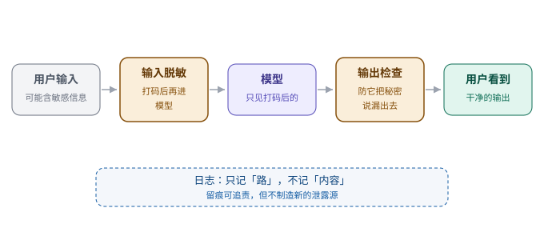

# 第 13 章　守口如瓶，守住商业秘密与个人隐私

> 第四部分 · 边界。这一章讲：怎么让一个「能说会道」的 agent，不把不该说的说出去——答案是在输入和输出两头设卡。

---

## 一个「嘴上没把门」的同事

想象你公司有个同事小 A，什么都好，就是**嘴巴不牢**。

今天开完会，你刚交代完「这个新品的报价是底价，千万别让客户知道」，他转头就在跟客户聊天时，顺嘴来了一句：「其实我们内部这个价还有空间……」

更要命的是，他还不是「故意」的。他只是**不懂分寸**：他分不清哪些话能说、哪些话是红线。你问他「客户的手机号是多少」，他张口就报；你让他「把上个月的合同发我」，他连合同的保密条款一起发过来了。

**这种「不是坏心，但会闯祸」的同事，你敢让他碰公司的机密吗？**

一个 agent，本质上就是这样一个「嘴上没把门」的模型——它不知道什么叫「商业秘密」，什么叫「个人隐私」。它只负责「流利地回答」，不负责「什么该说什么不该说」。

这一章，就讲怎么给它「封口」。

---

## 要守住的，就两类东西

先明确：我们要保护的对象，就**两类**。

**第一类：企业的商业秘密。**
配方、报价、客户名单、未公开的合同、还没发布的产品计划……这些一旦泄露，轻则丢单，重则吃官司。

**第二类：个人的隐私。**
身份证号、手机号、银行卡号、病历、住址、家庭情况……这些是法律明令要保护的（比如个人信息保护法），泄露了不光伤用户，还要担法律责任。

这两类东西，有一个共同点：**它们会「藏在」用户输入的话里、上传的文件里、以及 agent 输出的内容里，一不小心就溜出去。**

所以，「守口如瓶」这件事，关键就一句话：**让这些敏感信息，尽可能「别进」模型，也「别出」模型。**

---

## 巧思一：输入输出两头设卡，先脱敏再进模型

怎么「封口」？核心的巧思，是**在两头设卡**：

> **输入的一头（进模型前）：先脱敏，把敏感信息「打码」掉，再喂给模型；**
> **输出的一头（出模型前）：再检查一遍，防止它把敏感信息说出去。**

我们重点看**输入这一头**，因为它最关键——**只要敏感信息压根没进模型，模型自然就没法泄露它。**

具体怎么做？叫**脱敏（PII redaction，个人可识别信息脱敏）**：

在用户的话、上传的文件「进模型」之前，系统先扫一遍，把里面的敏感信息**识别出来、替换掉**：

| 敏感信息 | 脱敏前 | 脱敏后 |
|---|---|---|
| 手机号 | 138-1234-5678 | `[手机号]` |
| 身份证号 | 310101199001011234 | `[身份证]` |
| 邮箱 | zhang@company.com | `[邮箱]` |

这样，模型从头到尾**根本没见过**那个真实的手机号——它只看到 `[手机号]` 这个占位符。**模型没见过的秘密，它自然说不出去。**

这就像公司里「涉密信息对外一律用代号」的做法：内部叫「A 客户」「X 项目」，外人听了也摸不着头脑。

---

## 输出这头，也不能放松

光在输入脱敏，够了吗？不够。还要看**输出**。

因为敏感信息有两条「溜出去」的路：

1. **输入带进来的**——这个靠「输入脱敏」堵住；
2. **模型「凭空」说出来的**——比如模型在别处「记住」了一个真实手机号，或者它编造了一个看起来像真的身份证号，随回复一起吐出来。

第二条路，输入脱敏堵不住，得在**输出这一头再设一道卡**：模型回复之前，同样扫一遍，把可能泄露的敏感信息**拦截或打码**。

**输入卡一道，输出卡一道**，两道卡合起来，才算是「守口如瓶」。

---

## 巧思二：日志只记「路」，不记「内容」

还有一个容易被忽略的泄露口：**日志。**

系统为了「可追溯」，会记很多日志：用户发了什么、agent 回了什么、调用了什么。这本是好事（第 5 章我们说过「留痕」很重要）。

但问题来了：**日志里，会不会也把敏感信息「原样」记下来了？**

如果日志里记的是「用户手机号 138-1234-5678，回复了……」，那这份日志本身，就成了一个新的泄露源——谁有权限看日志，谁就看到了用户的手机号。

所以有一个很妙的巧思：

> **日志只记「路」，不记「内容」。**

什么叫「记路不记内容」？打个比方：

- ❌ 记内容：「用户输入了身份证号 310101……，agent 调用了查询接口，返回了……」
- ✅ 记路：「有一条消息进来，触发了一次工具调用，返回了结果」——**只记「发生了什么动作」，不记「动作里具体是什么内容」。**

这就好比快递的**物流轨迹**：你查快递，看到的是「已揽收 → 已到达转运中心 → 派送中」这条**路**，而不是快递**里面装的是什么**。

**记「路」，能追责、能排查；不记「内容」，就守住了秘密。** 两者兼得。

---

## 这一章，你只要带走三句话

1. **要守住的就两类：企业的商业秘密 + 个人的隐私**——它们会藏在输入、输出里溜出去；
2. **输入输出两头设卡**——输入先脱敏再进模型（模型没见过的秘密，自然说不出去），输出再查一道；
3. **日志只记「路」，不记「内容」**——留痕是为了追责，不是为了再制造一个泄露源。

「守口如瓶」解决了「不该说的别说」。但边界还有第二件事：**它得先搞清楚，你「到底想干什么」**——否则它再守口如瓶，也可能听岔了、干错活。

这就是下一章——**意图识别**。

---

> 本章配图（已产出，存于 assets/）：
> - 图 13-1　示意图：fig-13-1-redaction.svg（输入输出两头设卡）
