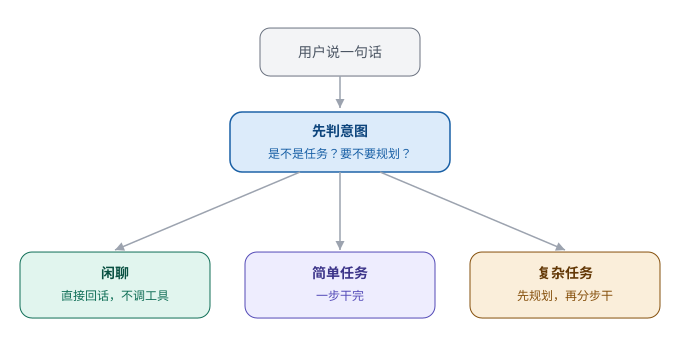

# 第 14 章　先搞清楚，你到底想干什么

> 第四部分 · 边界。这一章讲：一句话背后可能藏着十个意思——agent 得先「听懂」，再动手，否则会干错活。

---

## 一句「帮我看看」，能有多少种意思

想象你早上到公司，随手跟同事小 A 说了一句：「帮我看看今天的数据。」

然后你就去开会了。

一个小时后你回来，发现小 A 干了这么些事：他把全公司**所有**的数据库都翻了一遍，把**所有**「今天」的数据都下载下来，生成了一份 200 页的报告，还顺手给全部门群发了一封邮件。

你哭笑不得：「我就是想让你看看今天**我负责的那个项目**的**进度**数据，你这是在干嘛？」

小 A 一脸委屈：「你不是说『看看今天的数据』吗？我又不知道你说的是哪个数据……」

**这就是「意图识别」的问题。**

同一句话——「帮我看看今天的数据」——在不同的人嘴里、不同的场景下，意思**完全不同**。而 agent 如果「听岔了」，就会**干错活**，甚至干出一堆你根本没想要的活来。

---

## 为什么「听懂」比「会说」难

你可能会想：模型不是很擅长「理解语言」吗？它怎么会听岔？

因为「理解语言的字面意思」，和「理解说话人的真实意图」，是两码事。

一句话背后，藏着很多「没说出口」的信息：

- **你到底想让我「查」，还是「分析」，还是「直接做」？** 「看看数据」可能是想「查个结果」，也可能是想「做份分析报告」；
- **这是一句「闲聊」，还是一个「正经任务」？** 「今天天气真好」是闲聊，「帮我整理今天的销售数据」是任务；
- **这件事，是「马上就能干完」，还是「要规划一番、分几步干」？** 「查个数」一步就完，「做一份市场调研报告」得规划好几步。

如果 agent 不分青红皂白，对每一句话都「一视同仁」地处理，就会出问题：

- 把「闲聊」当成「任务」，兴师动众地调一堆工具——浪费；
- 把「复杂任务」当成「简单问答」，随口糊弄一句——敷衍；
- 把「模糊的请求」当成「明确的指令」，脑补一堆细节就开干——闯祸。

**所以，动手之前，先要把「意图」搞清楚。**

---

## 巧思：先判「是不是任务、要不要规划」，再决定怎么干

怎么「搞清楚意图」？核心的巧思，是一个**前置的判断步骤**：

> **在正式干活之前，先花一小步，判断：① 这是不是一个「任务」？② 如果是，要不要「规划」？——然后，再根据判断结果，决定怎么干。**

这个判断，通常就两个问题：

**问题一：这是「任务」，还是「闲聊」？**

- 用户说「你好」「今天心情不错」——这是**闲聊**，直接回一句就行，不用调任何工具；
- 用户说「帮我查一下上季度的销售额」——这是**任务**，要动真格地调用工具去干。

先把「闲聊」和「任务」分开，能省掉一大半「瞎忙活」——**不是每句话都要兴师动众。**

**问题二：这是「一步就完的活」，还是「要规划的多步任务」？**

- 「查一下今天天气」——**一步就完**，查完直接回；
- 「帮我做一份竞品分析报告」——这要**规划**：先查资料 → 再分析 → 再写报告 → 可能还要配图表，好几步。

对于「要规划」的任务，agent 就得**先列个计划，再一步步执行**，而不是上来就瞎干。

**「先判意图，再决定怎么干」**——这一步看似不起眼，却是「靠谱」和「瞎忙」的分水岭。

---

## 为什么「先判断」这么重要

你可能会问：多这一步判断，会不会太啰嗦、拖慢速度？

恰恰相反。这一步**很轻**（通常就一次快速的小判断），但它**省下的麻烦，是大大的**：

- **省资源**：把「闲聊」挡在外面，不浪费一次工具调用的开销；
- **防干错**：把「模糊请求」先搞清楚，避免脑补细节、干出一堆你没要的东西；
- **提效率**：把「要规划的任务」先规划好，比「上来瞎干、干一半发现方向错了再返工」快得多。

这就像一个好员工接到活，不会二话不说就闷头干，而是会先问一句、先想一下：**「这个活，是让我干嘛？我要不要先列个计划？」** 问清楚再干，反而更快、更对。

---

## 这一章，你只要带走三句话

1. **一句话背后可能藏着十个意思**——字面理解 ≠ 真实意图，听岔了会干错活；
2. **动手前，先判意图**——这是不是「任务」？要不要「规划」？再决定怎么干；
3. **「先判断」不啰嗦，反而省事**——省资源、防干错、提效率。

「意图识别」解决了「听没听懂」。但边界还有最后一件、也是最微妙的一件事：**就算它听懂了、也想对了，可信息一多，它还是容易「分心」——跑题、抓不住重点。**

怎么让它「心无旁骛，只做最要紧的事」？这就是下一章——**相关性检查**。

---

> 本章配图（已产出，存于 assets/）：
> - 图 14-1　示意图：fig-14-1-intent.svg（先判意图，再动手）
