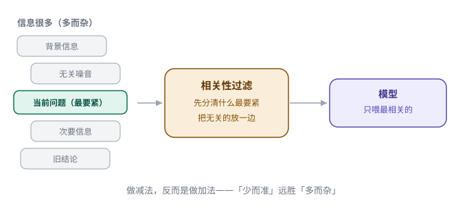

# 第 15 章　心无旁骛，只做最要紧的事

> 第四部分 · 边界。这一章讲：信息一多，模型就容易「分心」——怎么让它始终盯着「最要紧的那件事」。

---

## 一个「开会时越听越跑题」的同事

想象你在开一个重要的项目会。

会议的主题是「下个季度要砍掉哪些不赚钱的产品线」。这是个需要聚焦的决策。可会议开着开着，气氛就变了：

- 有人提了一句「对了，我们的官网是不是该改版了」，话题就拐到了网页设计；
- 又有人插嘴「上次团建那个餐厅不错」，大家开始聊起了吃的；
- 最后，本来要讨论「砍产品线」，结果散会时，定下来的却是「下周去团建」。

**问题出在哪？不是大家不聪明，而是「信息一多，就分心了」。**

会议里每多一个「新话题」，就把所有人的注意力，从「最要紧的那件事」上，往外拽走一点。拽着拽着，重点就丢了。

**一个 agent，面对海量信息时，也会这样「分心」。**

---

## 模型为什么会「分心」

先搞清楚：模型为什么会被「信息」带跑？

因为模型处理信息，有一个天然的弱点：**它分不清「主次」。**

你把一堆信息摆到它面前——有的是当前问题的核心，有的是沾点边的背景，有的是完全无关的噪音——它不会自动地「抓重点」。相反，它很可能：

- **跑题**：被一条无关的信息吸引，答着答着就跑到了别的话题上；
- **抓错重点**：把次要的信息当成主要的，把真正要紧的给忽略了；
- **越答越乱**：信息越多，它越容易「贪多嚼不烂」，最后给出一个面面俱到、但哪都不准的答案。

这背后的道理，其实很朴素：**模型的「注意力」，是有限的。信息越多，注意力被摊得越薄，它就越容易「看花眼」。**

所以，问题的关键，不是「怎么让模型更专注」（模型改不了），而是**「怎么别把太多信息一股脑塞给它」**。

---

## 巧思：相关性过滤——先分清「什么最要紧」，只喂真正相关的

既然「信息越多，越容易分心」，那解法就呼之欲出了：

> **在把信息喂给模型之前，先做一次「相关性过滤」——只把「当前最要紧、最相关」的信息喂给它，其余的先放一边。**

这就像开会时，一个称职的主持人会做的：**「咱们先别跑题，回到主题上来。」** 他会把跟主题无关的讨论，轻轻地挡在一边，把所有人的注意力，重新拉回到「最要紧的那件事」上。

具体到 agent，这套「相关性过滤」是这样运作的：

1. **判断「当前最要紧的是什么」**：用户现在问的、正在推进的，是哪一件事？它的优先级最高；
2. **筛选信息**：把手里的一堆信息（上下文、检索到的知识、工具返回的结果……）过一遍，只保留「和当前这件事真正相关」的；
3. **只喂相关的**：把筛选后的、精简的信息喂给模型，让它「心无旁骛」地处理这件事。

**信息不是越多越好，是「越专注、越聚焦越好」。**

---

## 为什么「做减法」，反而是「做加法」

你可能会疑惑：把信息「减掉」一部分，模型不会「知道的更少」吗？那岂不是答得更差了？

这里藏着一个反直觉的道理：

> **对模型来说，「少而准」的信息，远胜「多而杂」的信息。**

因为模型「知道得再多」，如果里面掺了一堆**无关的、甚至矛盾的**信息，它反而会：

- 被无关信息带跑（跑题）；
- 被矛盾信息搞糊涂（一会儿这个说法、一会儿那个说法，最后自相矛盾）；
- 注意力被摊薄（哪件事都想顾及，哪件事都没答透）。

而当你**只给它「最相关的那几条」**时，它反而能**集中全部注意力，把这一件事答得又准又透**。

这跟「记忆要舍得忘」（第 5 章）、「上下文要精简」（第 4 章）、「知识库只喂最相关的一页」（第 10 章）是**同一条主线**：

> **贯穿全书的一个道理：企业级 agent 的「可靠性」，很大程度来自「克制地做减法」——不贪多，只喂对。**

**「心无旁骛」，不是模型天生的品质，而是系统帮它「过滤」出来的状态。**

---

## 这一章，你只要带走三句话

1. **信息一多，模型就容易分心**——跑题、抓错重点、越答越乱，因为它的注意力有限；
2. **相关性过滤**——先分清「什么最要紧」，只喂真正相关的，其余先放一边；
3. **做减法，反而是做加法**——「少而准」远胜「多而杂」，专注才能答得又准又透。

到这里，「边界」这一部分的三条纪律——**守口如瓶（脱敏）、先想清楚（意图识别）、心无旁骛（相关性检查）**——就讲完了。

这几条，管的都是「模型」这个人的言行。但一个企业级的 agent，不只是一个「人」——它还是一套「系统」：一百个人用的时候，谁有权限、干过什么、系统健不健康、谁来管？

这些「系统级」的事，就是最后一部分——**治理**。

---

> 本章配图（已产出，存于 assets/）：
> - 图 15-1　示意图：fig-15-1-relevance.svg（相关性过滤：只喂最要紧的）
