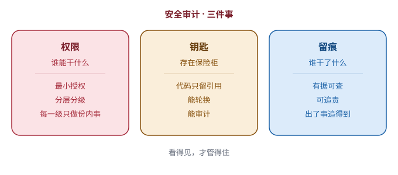

# 第 16 章　谁能干什么，钥匙放哪

> 第五部分 · 治理。这一章讲：一百个人用一套系统，谁能干什么、钥匙放哪、干过什么要留痕——这是系统级的「安全审计」。

---

## 一个「谁都能进财务室」的公司

想象一家公司，管理混乱到这种程度：

- **财务室的钥匙，就挂在门口的墙上**，谁路过都能拿；
- **所有人**都能登录公司的客户数据库，包括刚入职一天的实习生；
- 有人半夜偷偷改了一笔账，**第二天没人发现**，因为根本没记录「是谁、在什么时候、改了什么」。

你肯定会说：这公司迟早出事。

但你再想想——**很多企业级系统，一开始就是这个状态。**

一个 agent 系统，一旦给「一百个人」用，就会冒出一堆新的、系统级的问题：

- 谁能用？谁能配模型？谁能看审计日志？谁能删数据？
- 那些「钥匙」（API Key、数据库密码、各种令牌），存在哪？会不会被人看到？
- 谁在什么时候干了什么，有没有**留痕**？

这些，就是「安全审计」要管的事。这一章，讲三件事：**权限、钥匙、留痕。**

---

## 第一件事：权限——谁能干什么，分层分级

第一件事，是**权限**：谁，能干，什么。

这里有一个核心原则，叫**「最小授权」**：

> **每个人（每个角色），只给它「恰好够用」的权限，不多给一分。**

为什么要「最小授权」？因为**权限越大，风险越大**。一个只能「看」的人，你偏偏给了他「删」的权限，那他一旦误操作（或账号被盗），就是灾难。

怎么落地「最小授权」？通常靠**分层分级**的权限模型。比如很常见的「三级」：

| 层级 | 角色 | 能干什么 | 打个比方 |
|---|---|---|---|
| L0 | **超级管理员** | 管整个系统：配模型、管用户、看所有数据 | 公司老板 / 系统管理员 |
| L1 | **管理员** | 管自己负责的那一摊，不能越权 | 部门主管 |
| L2 | **普通用户** | 只能用、只能看自己的东西 | 普通员工 |

这个分层的核心，是**「每一级只做份内的事」**：

- 普通用户，不能去配模型、不能看别人的数据；
- 管理员，不能改系统的「根基」设置；
- 超级管理员，才能碰最核心的配置。

**权限这件事，宁可让一个人「临时缺一点权限、找你申请」，也不能让他「常年握着他用不上的权力」。**

---

## 第二件事：钥匙——存在保险柜里，不写死在代码里

第二件事，是**钥匙**：那些 API Key、数据库密码、各种令牌，存在哪？

这是最容易出事的环节。很多系统的「钥匙」，是被**写死在代码里**的——直接把 API Key、数据库密码这些明文，硬编码进程序里。

为什么危险？因为：

- **代码会到处流传**：代码库会 clone、会分享、会提交到开源仓库，一不留神，钥匙就跟着代码一起泄露了；
- **改钥匙等于改代码**：钥匙泄露了，你得改代码、重新部署，又慢又容易出错；
- **人人可见**：谁有代码，谁就看到钥匙，根本谈不上「最小授权」。

所以正确的做法，是把钥匙**存进「保险柜」**——也就是专门的**密钥管理服务**（比如 Vault）：

- **钥匙在保险柜里，代码里只留一个「引用」**（比如「去保险柜取 `db_password`」），代码里永远看不到真实的钥匙；
- **取钥匙要凭证**：只有「有权限」的程序或人，才能在运行时、按需从保险柜里取出来用；
- **能轮换、能审计**：钥匙可以定期更换，谁在什么时候取过哪把钥匙，都有记录。

**钥匙放保险柜，代码只留引用**——这是系统安全的一条铁律。它和「记忆要分级」「权限要分层」是同一个精神：**该藏的东西，藏到该藏的地方。**

---

## 第三件事：留痕——谁干了什么，有据可查

第三件事，是**留痕**：谁、在什么时候、干了什么。

权限管「能不能干」，钥匙管「安不安全地干」，而留痕，管的是**「出事后，查不查得清」**。

一个系统，如果「谁都能干、干了还没记录」，那出了事，就是一笔糊涂账——你连「是谁干的」都不知道。

所以，一个靠谱的系统，会**审计日志**：

> **把「关键动作」都记下来：谁（哪个用户）、在什么时候、干了什么（改了什么配置、删了什么数据、用了哪个模型）。**

这跟第 5 章的「先记账再干活」、第 9 章的「工具链可视化」是同一个思路，但**上升到了系统级**：

- 有人偷偷删了数据？审计日志里查得到「是谁、几点删的」；
- 有人越权配了个不该配的模型？审计日志里查得到「是谁、配了什么」；
- 出了安全事故要追责？审计日志就是**证据**。

**「看得见，才管得住」**——留痕，是「管得住」的前提。这句话，也是下一章的主题。

---

## 这一章，你只要带走三句话

1. **权限要「最小授权」、分层分级**——每一级只做份内的事，不多给一分；
2. **钥匙放保险柜，不写死在代码里**——代码只留引用，钥匙能轮换、能审计；
3. **关键动作要留痕**——谁、何时、干了什么，有据可查，出了事才追得到。

「安全审计」管的是「谁能干什么」。但一个系统要真正「管得住」，光有权限和留痕还不够——你得**看得见**：进度到哪了、成果是什么、系统健不健康、有没有跑偏。

这就是下一章——**可观测性**。

---

> 本章配图（已产出，存于 assets/）：
> - 图 16-1　示意图：fig-16-1-security-audit.svg（安全审计三件事：权限、钥匙、留痕）
