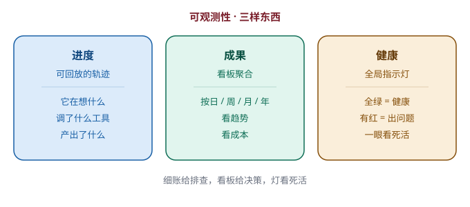

# 第 17 章　看得见，才管得住

> 第五部分 · 治理。这一章讲：一个能干的员工，也得「看得见」才管得住——把 agent 的进度、成果、健康，都变成「看得见」的东西。

---

## 一个「看不见、管不住」的团队

想象你是团队主管，手下带着一群人。

现在问你一个问题：**你凭什么「管」他们？**

答案不是「凭权威」，而是**凭「看得见」**：

- 你得**看得见进度**——每个人手上那摊活，干到哪一步了；
- 你得**看得见成果**——他到底产出了什么，是好是坏；
- 你得**看得见健康**——有没有人卡住了、有没有人干偏了、有没有人悄悄「磨洋工」。

如果你这些都看不见，那你就不是「主管」，你只是个「挂名的」——因为你没法判断谁干得好、谁该帮一把、谁出了问题。

**「看得见」，是「管得住」的前提。** 这个道理，管人如此，管 agent 系统，一模一样。

当你把一堆 agent 交给一家企业用，你就会面临同样的拷问：**这一堆 agent 在干什么、干得怎么样、花了多少钱、健不健康——你，看得见吗？**

---

## 把 agent 的「工作」，沉淀成一条可回放的轨迹

第一个要解决的问题：**agent 干活的「过程」，怎么看得见？**

agent 不像人，它干活的「过程」是抽象的——它在「想」、在「调用工具」、在「生成」，这些都是看不见的「黑盒」。要「管」它，就得先把这些看不见的，变成看得见的。

这里有一个很关键的巧思：

> **把 agent 的「工作进度」和「工作成果」，沉淀成一条「可回放的轨迹」。**

这条轨迹，就像一段**行车记录仪**的录像——事后你可以「回放」，看清楚它这一路到底干了什么：

- **它在想什么**：模型的推理过程，一步步留下来了；
- **它调了什么工具**：查了哪个库、调了哪个接口、用了哪个 skill，全在轨迹里；
- **它产出了什么**：生成了什么文件、算出了什么结果，挂在了轨迹上；
- **它花了多少 token**：这一趟下来，成本是多少，一目了然。

有了这条轨迹，一切就透明了：

- 用户投诉「它答错了」？——**回放轨迹**，看它哪一步想岔了；
- 老板问「这个月 agent 都干了啥」？——**翻轨迹**，一桩桩都查得到；
- 出了事故要追责？——**轨迹就是证据**。

**「看不见的过程」，一旦沉淀成「可回放的轨迹」，就从黑盒变成了白盒。** 这就是可观测性的地基。

---

## 把「轨迹」，聚合成「看板」

光有一条条的轨迹还不够。轨迹是「细账」，而管理者需要的是「**总账**」——从全局的视角，一眼看清「整体怎么样了」。

所以有了第二个巧思：**聚合。**

> **把一条条细碎的轨迹，按时间聚合成「看板」——按日、按周、按月、按年，看全局的趋势。**

怎么聚合？关键在「**粒度**」：

- 最细的粒度是**小时**：每一小时，agent 跑了多少活、花了多少 token、产出了多少东西，记一笔；
- 往上是**日、周、月、年**：把这些小时级的账，逐级汇总。

这样一来，管理者打开看板，就能看到：

- **今天** agent 系统跑了多少会话、多少任务、花了多少钱；
- **这个月**的趋势是涨还是跌，哪类任务最多；
- **今年以来**，agent 给公司省了多少人力、产出了多少东西。

这跟企业里的「经营报表」是一个道理：**细账给一线排查用，看板给管理层决策用。** 有了看板，「管得住」才有了抓手。

---

## 全局的「指示灯」：一眼看系统死活

最后，还有一个最基础、但最容易被忽略的东西：**系统的「死活」，怎么一眼看出来？**

一套 agent 系统，背后可能挂了十几个服务：模型服务、数据库、向量库、存储、消息队列……任何一个「挂了」，整个系统都可能「卡住」。

如果你每次都要**人工逐个去查**「这个服务还活着吗、那个服务通不通」，那等你查完，用户早就等疯了。

所以有了第三个巧思：**全局的「在线指示灯」。**

> **把每个关键服务的健康状态，汇总成一盏「全局灯」：全绿，系统健康；有红，一眼就知道「哪个环节出问题了」。**

这跟第 9 章「状态指示灯」是同一个思路，但**从「单个 agent 的状态」上升到了「整套系统的健康」**：

- **单个 agent 的灯**：这个 agent 是在想、还是卡住了；
- **全局的灯**：这一整套系统，是活着、还是哪个服务挂了。

**「一眼看死活」**，听起来简单，但它是一个系统「能不能被放心地交出去运营」的底线——**连「死没死」都看不出来，还谈什么管？**

---

## 这一章，你只要带走三句话

1. **「看得见」是「管得住」的前提**——管人如此，管 agent 系统亦然；
2. **把过程沉淀成「可回放的轨迹」**——它在想什么、调了什么、产出了什么、花了多少，全程可查；
3. **轨迹聚合成看板，再加一盏全局指示灯**——细账给排查，看板给决策，灯看死活。

到这里，系统已经「看得见、管得住」了。但还剩最后、也是最「行政」的一个问题：**这一整套系统，到底「谁来管」？**

——人。管人（谁能进来）、管权（谁能干什么）、管资源（谁能配什么）。这就是最后一章——**后台管理**。

---

> 本章配图（已产出，存于 assets/）：
> - 图 17-1　示意图：fig-17-1-observability.svg（可观测性：进度、成果、健康）
