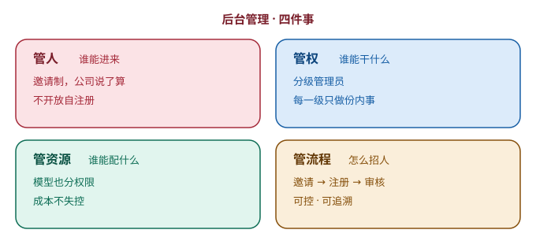

# 第 18 章　谁来管这个系统

> 第五部分 · 治理。这一章讲：一百个人用，谁来管——这其实就是企业的「行政管理」，落到系统上，就是「后台管理」。

---

## 公司里，最容易被忽略的部门

想象一家公司，业务蒸蒸日上，产品、销售、技术，个个都很能干。

但有一个部门，平时**最不显眼**，也最容易被忽略——**行政和 HR**。

它不直接创造利润，可一旦它缺位，公司立刻乱套：

- 没人管「谁能进公司」，随便谁都能进来，门禁形同虚设；
- 没人管「谁能干什么」，谁都能进财务系统、谁都能改核心数据；
- 没人管「公司有多少资源」，电脑随便领、预算随便花；
- 没人管「人怎么招进来」，面试流程、入职门槛，全靠拍脑袋。

**业务再强，行政缺位，公司迟早崩。** 这套「行政管理」，翻译成系统语言，就是——**后台管理（Admin）**。

一个企业级 agent，当「一百个人」都在用的时候，同样需要一个「后台」，来管四件事：**管人、管权、管资源、管流程。**

---

## 管人：谁能进来，由公司说了算

第一件事，**管人**——谁能进这个系统。

这里有一个很关键的设计选择：**是「开放自注册」，还是「邀请制」？**

- **开放自注册**：谁都能来注册一个账号。好处是「门槛低、好推广」；坏处是「谁都能进来」，安全上是个大窟窿；
- **邀请制**：想进来，得由公司（管理员）**发邀请**，被邀请的人才能注册。好处是「谁进来，公司说了算」；坏处是「麻烦一点」。

一个面向企业内部、要处理敏感数据的 agent，几乎都会选**邀请制**：

> **入职由公司把关，不开放自注册——谁进来，由公司说了算。**

这跟现实里「进公司要面试、要办入职」是一回事：**不是谁想进就能进，得公司「招」你。**

**「谁进来」，是一个系统安全的第一道门。** 这道门，必须攥在公司手里。

---

## 管权：分级管理员，每一级只做份内的事

第二件事，**管权**——谁能干什么。

这其实是第 16 章「权限分层」的**落地**。后台管理里，权限不是「一人一个自定义权限」，而是**分级的管理员**：

| 层级 | 角色 | 能干什么 | 打个比方 |
|---|---|---|---|
| L0 | 超级管理员 | 管整个系统 | 老板 |
| L1 | 管理员 | 管自己那一摊 | 主管 |
| L2 | 普通用户 | 只用、只看自己的 | 员工 |

这个分级的核心，就一句话：**每一级，只做份内的事。**

- 普通用户，别想着去配模型、看别人的数据；
- 管理员，别想着去动系统的「根基」；
- 超级管理员，才碰最核心的东西。

**「分级」，本质是「责任」的分级——权力和责任，一起分下去。** 谁管哪一摊，谁就只对那一摊负责。

---

## 管资源：谁能配什么模型，也要管住

第三件事，**管资源**——公司有哪些「资源」，谁有资格用。

agent 系统里，最典型的一类资源，就是**模型**。

还记得第 3 章「分层用模型」吗？强的模型贵、弱的模型便宜。那问题来了：**公司买了一堆模型，是不是谁都能随便用最贵的那个？**

如果不管，就会出现「实习生也天天用最贵的旗舰模型」——**成本失控**。

所以后台管理要**管资源**：谁能配什么模型、谁能用哪个模型，都是**有权限、有配额**的。

这跟现实里「公司配电脑、配权限」是一个道理：**实习生配的是基础款，总监配的是顶配；你要用顶配，得有那个权限。**

**资源管不住，成本就失控；成本失控，再好的系统也撑不下去。**

---

## 管流程：邀请制怎么「招人」

第四件事，**管流程**——「招人」这件事，怎么走。

光「邀请制」三个字，还不够。得把它落成一条清晰的流程：

1. **管理员发起邀请**：填个邮箱，发一份邀请出去；
2. **被邀请人受邀注册**：拿到邀请，才能注册账号；
3. **公司审核把关**：管理员能随时看「邀请发出去了、有没有被用掉、还能不能收回」。

这条流程，保证了「谁进来」这件事，**每一步都可控、可追溯**：

- 邀请发出去了，有记录；
- 邀请被人用了，有记录；
- 邀请想收回，随时能收回（比如发错了人、或者那个人不该进来了）。

**「招人」这件事，从头到尾，都攥在公司手里。** 这就是「流程」的意义——不是「嘴上说邀请制」，而是「有一套能跑、能查、能收回的流程」。

---

## 这一章，你只要带走三句话

1. **后台管理，就是系统的「行政管理」**——管人、管权、管资源、管流程；
2. **管人是邀请制，不开放自注册**——谁进来，公司说了算；管权是分级管理员，每一级只做份内事；
3. **管资源（谁能配什么模型）也要管住，管流程（怎么招人）要可控可追溯**——否则成本失控、安全失守。

---

## 写在最后：把「新同事」，培养成「靠谱的骨干」

到这里，这本书的十八个章节，就全部走完了。

回望这一路，我们其实只做了一件事：

> **把企业级 agent，当成一个「刚入职、值得培养的新同事」，从里到外，把它一步步培养成一个「靠谱的骨干」。**

我们走过了五站：

1. **智力**——先让它想得清、记得住（模型分类、上下文、记忆）；
2. **能力**——再让它做得成、说得清（skill、API 转 MCP、多模态、UI）；
3. **协作**——然后让它学会一起干（知识库、子 agent、task 调度）；
4. **边界**——接着给它立工作纪律（脱敏、意图识别、相关性检查）；
5. **治理**——最后把系统级的事管起来（安全审计、可观测性、后台管理）。

而贯穿这五站的，是那些反复出现的、看似不起眼却极其精妙的**巧思**：

- **先记账，再干活**——账，永远比活先落；
- **两本账**——给用户看的账事无巨细，给模型看的账高度精简；
- **舍得忘**——真正的记忆，是「把有价值的提炼出来」，不是「全都存起来」；
- **做减法**——信息不是越多越好，是越专注、越聚焦越好；
- **过程可弃，成果必留**——子 agent 是临时工，但它的产出留在你桌上；
- **看得见，才管得住**——把黑盒打开，把过程沉淀成可回放的轨迹。

这些巧思，没有一个是「换一个更强的模型」能解决的。它们靠的，是一圈**工程化的设计**——也正是这本书最想传达的东西：

> **决定一个企业级 agent 靠不靠谱的，从来不是那颗「多聪明的大脑」，而是模型外面，那一圈让它「从能跑，到能扛」的设计。**

所以，下次当你再看到一个新出的、号称「更强」的模型时，不妨问自己一句——

**「如果它是我新招的同事，我该帮它长出什么本事，它才算真正靠谱？」**

这个问题想清楚了，你就不再是「追模型的人」，而是「设计靠谱系统的人」。

祝你在培养这个「AI 新同事」的路上，越走越顺。

---

> 本章配图（已产出，存于 assets/）：
> - 图 18-1　示意图：fig-18-1-admin.svg（后台管理四件事）
